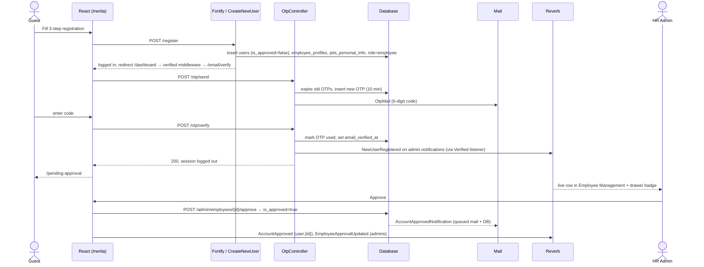
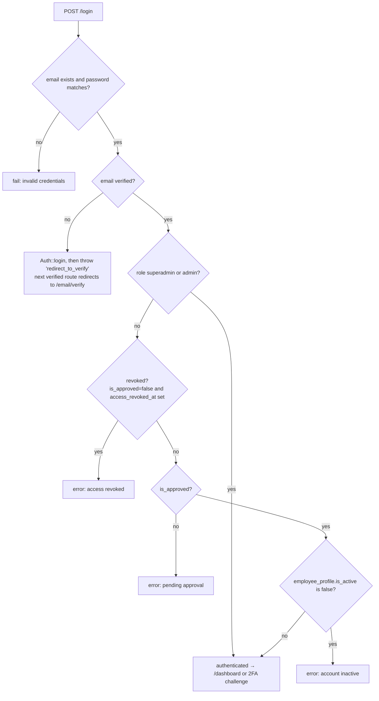
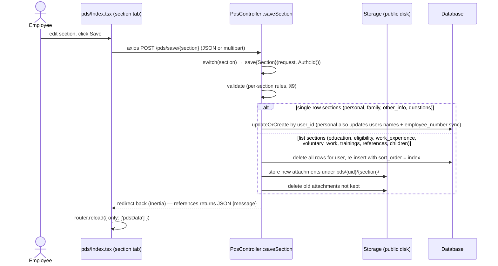
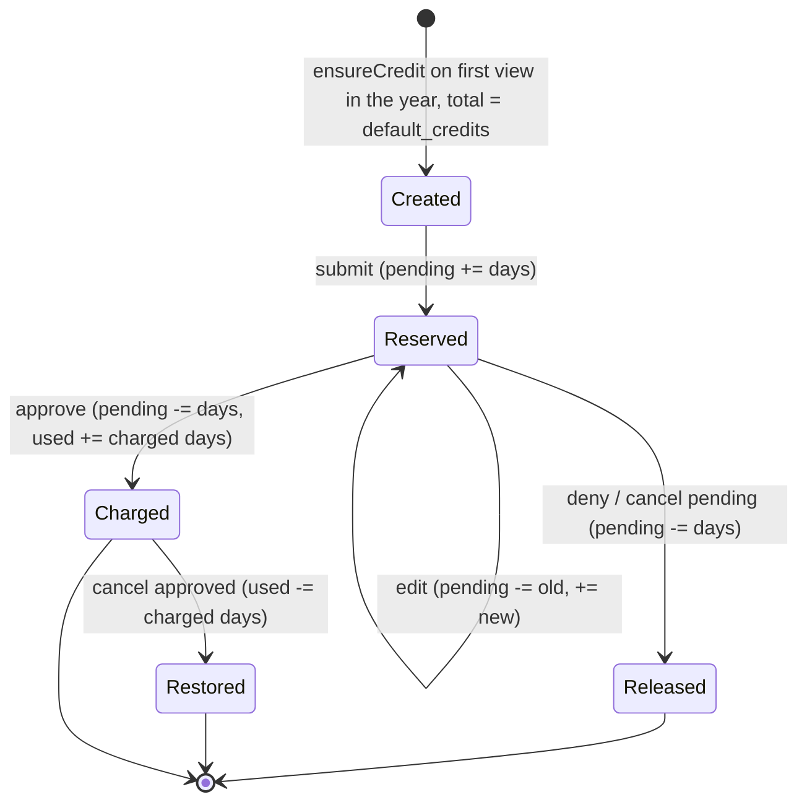
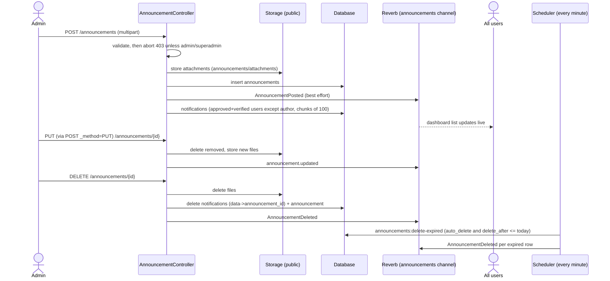

# DARFO5 HRMS — System Documentation

Generated from the source code on 2026-09-30 (branch `main`, latest commit `06b5093`). Where the code does not make something clear, this document says **Unclear** instead of guessing.

## 1. Table of Contents

1. [Table of Contents](#1-table-of-contents)
2. [Project Overview](#2-project-overview)
   - [Purpose](#21-purpose)
   - [Tech stack](#22-tech-stack)
   - [Setup / installation](#23-setup--installation)
   - [Environment variables](#24-environment-variables)
   - [How to run](#25-how-to-run)
3. [Architecture](#3-architecture)
   - [Folder structure](#31-folder-structure)
   - [How backend and frontend connect](#32-how-backend-and-frontend-connect)
   - [Authentication](#33-authentication)
   - [Authorization](#34-authorization)
   - [Real-time broadcasting](#35-real-time-broadcasting)
   - [Scheduled tasks and queue](#36-scheduled-tasks-and-queue)
   - [Third-party integrations](#37-third-party-integrations)
4. [Database](#4-database)
   - [Entity-relationship diagram](#41-entity-relationship-diagram)
   - [Table reference](#42-table-reference)
   - [Eloquent relationships](#43-eloquent-relationships)
   - [Seeders](#44-seeders)
5. [Roles & Permissions](#5-roles--permissions)
6. [Pages](#6-pages)
7. [Functions](#7-functions)
8. [Flows](#8-flows)
9. [API Endpoints](#9-api-endpoints)
10. [Gaps & Observations](#10-gaps--observations)

---

## 2. Project Overview

### 2.1 Purpose

DARFO5 HRMS (branded in the UI and emails as "DA RFO 5 - HRIS") is a Human Resource Information System for the Department of Agriculture Regional Field Office 5. It covers:

- **Employee onboarding.** Employees self-register, verify their email with a one-time code (OTP), then wait for HR approval.
- **Employee records.** The employee profile, the Personal Data Sheet (PDS, CSC Form 212) and service records.
- **Official documents.** The PDS, Work Experience Sheet (WES), Service Record (AFD-HRMS-012-0), ARTA ID card and CSC Form 6 (Application for Leave) are generated as PDFs.
- **Leave.** Filing, credit tracking, admin review, a calendar and holiday management.
- **Reference data.** Divisions, sections, positions, eligibilities, degrees, programs and holidays.
- **Communication.** Announcements plus real-time and database notifications.
- **Public ID verification.** QR codes on the ARTA ID resolve to a public employee page.

### 2.2 Tech stack

Versions below are the installed versions from `composer.lock` / `node_modules`. Constraints come from [composer.json](composer.json) and [package.json](package.json).

| Layer | Package | Constraint | Installed |
|---|---|---|---|
| Runtime | PHP | `^8.2` | 8.2.12 (local CLI) |
| Backend framework | `laravel/framework` | `^12.0` | 12.52.0 |
| Server-driven SPA | `inertiajs/inertia-laravel` / `@inertiajs/react` | `^2.0` / `^2.3.15` | 2.0.20 / 2.3.15 |
| Auth scaffolding | `laravel/fortify` | `^1.30` | 1.34.1 |
| Roles/permissions | `spatie/laravel-permission` | `*` | 6.24.1 |
| WebSockets | `laravel/reverb` + `laravel-echo` + `pusher-js` | `*` / `^2.3.0` / `^8.4.0` | 1.8.0 / 2.3.0 / 8.4.0 |
| Typed routes | `laravel/wayfinder` + `@laravel/vite-plugin-wayfinder` | `^0.1.9` / `^0.1.3` | 0.1.13 |
| PDF (headless Chrome) | `spatie/browsershot` + `puppeteer` | `*` / `^24.40.0` | 5.4.0 / 24.40.0 |
| PDF (dompdf) | `barryvdh/laravel-dompdf` | `*` | 3.1.2 (installed; no usage found in `app/`) |
| QR codes | `endroid/qr-code` | `^5.0` | 5.1.0 |
| Frontend | `react` / `react-dom` | `^19.2.4` | 19.2.4 |
| Language | `typescript` | `^5.7.2` | 5.9.3 |
| Bundler | `vite` + `laravel-vite-plugin` | `^7.0.4` / `^2.0` | 7.3.1 |
| CSS | `tailwindcss` (v4, via `@tailwindcss/vite`) | `^4.0.0` | 4.2.0 |
| UI primitives | Radix UI (`@radix-ui/*`, `radix-ui`), `@headlessui/react`, `lucide-react`, `cmdk`, `class-variance-authority` | — | — |
| Dialogs/toasts | `sweetalert2` | `^11.26.20` | 11.26.20 |
| Testing | `pestphp/pest` + `pest-plugin-laravel` | `^3.8` | 3.8.5 |
| Tooling | `laravel/pint`, `eslint`, `prettier`, `laravel/boost`, `laravel/pail`, `laravel/sail` | — | — |

**Database:** [.env.example](.env.example) defaults to `DB_CONNECTION=sqlite`. Several code paths use MySQL-only SQL, so the working target appears to be MySQL: `SET FOREIGN_KEY_CHECKS` in the location seeders, `TIMESTAMPDIFF(...)`/`CURDATE()` in [DashboardController.php](app/Http/Controllers/DashboardController.php), and code comments referencing "MySQL's DATE column". See [Gaps](#10-gaps--observations).

### 2.3 Setup / installation

`composer setup` ([composer.json](composer.json)) runs: `composer install` → copies `.env.example` to `.env` if missing → `php artisan key:generate` → `php artisan migrate --force` → `npm install` → `npm run build`.

Manual equivalent plus the extra steps this app needs:

```bash
composer install
cp .env.example .env
php artisan key:generate
# configure DB_* (MySQL recommended — see 2.2), MAIL_*, REVERB_*/VITE_REVERB_* and LEAVE_* in .env
php artisan migrate:fresh --seed     # roles, default users, reference data, PH locations, leave types, 10 demo employees
php artisan storage:link             # uploads use the "public" disk and are served via /storage/...
npm install
npm run build                        # or npm run dev
```

**Seeded accounts** ([RoleAndPermissionSeeder.php](database/seeders/RoleAndPermissionSeeder.php), [PermanentEmployeeSeeder.php](database/seeders/PermanentEmployeeSeeder.php)). The password for all of them is `password`.

| Email | Role |
|---|---|
| `superadmin@darfo5.hris.com` | superadmin |
| `admin@darfo5.hris.com` | admin |
| `permanent1@hris.com` … `permanent10@hris.com` | employee (Permanent, with PDS personal info and 5 service records each) |

**PDF prerequisites:** Browsershot needs Node, npm and a Chrome/Chromium that Puppeteer can drive. The binaries can be pinned with the `BROWSERSHOT_*` variables ([config/services.php](config/services.php), [PdfBrowsershot.php](app/Support/PdfBrowsershot.php)).

### 2.4 Environment variables

Standard Laravel keys are in [.env.example](.env.example): `APP_*`, `DB_*`, `SESSION_*` (database driver), `QUEUE_CONNECTION=database`, `CACHE_STORE=database`, `MAIL_*` (default `log`), `AWS_*`, `REDIS_*`, `BROADCAST_CONNECTION=log`. The app-specific keys are:

| Variable | Used in | Purpose |
|---|---|---|
| `LEAVE_FORM_TIMEZONE` (default `Asia/Manila`) | [config/leave.php](config/leave.php) | Local date for CSC Form 6 filing date, "as of" date, the `start_date` minimum. |
| `LEAVE_CERTIFYING_OFFICER_NAME` / `_TITLE` | config/leave.php | Name printed under CSC Form 6 section 7.A. |
| `LEAVE_RECOMMENDING_OFFICER_NAME` / `_TITLE` | config/leave.php | Name printed under 7.B. |
| `LEAVE_APPROVING_OFFICIAL_NAME` / `_TITLE` | config/leave.php | Name printed under 7.C/7.D. |
| `BROWSERSHOT_NODE_BINARY`, `BROWSERSHOT_NPM_BINARY`, `BROWSERSHOT_CHROME_PATH` | [config/services.php](config/services.php) | Optional binary paths for Browsershot. **Not listed in `.env.example`.** |
| `REVERB_APP_ID`, `REVERB_APP_KEY`, `REVERB_APP_SECRET`, `REVERB_HOST`, `REVERB_PORT`, `REVERB_SCHEME`, `REVERB_SERVER_HOST`, `REVERB_SERVER_PORT` | [config/reverb.php](config/reverb.php) | Reverb server/app. **Not listed in `.env.example`.** |
| `VITE_REVERB_APP_KEY`, `VITE_REVERB_HOST`, `VITE_REVERB_PORT` (default 8080), `VITE_REVERB_SCHEME` (default `http`) | [resources/js/echo.ts](resources/js/echo.ts) | Echo client connection. **Not listed in `.env.example`.** |
| `BROADCAST_CONNECTION` | config/broadcasting.php | Must be `reverb` for live updates; `.env.example` ships `log`. |
| `VITE_APP_NAME` | [resources/js/app.tsx](resources/js/app.tsx) | Browser tab title suffix (fallback `HRIS`). |

### 2.5 How to run

| Command | What it does |
|---|---|
| `composer dev` | Runs `php artisan serve`, `php artisan queue:listen --tries=1`, `npm run dev`, `php artisan reverb:start`, `php artisan schedule:work` concurrently. This is the primary dev command. |
| `composer dev:ssr` | Builds SSR, then runs server, queue, `pail` logs and `inertia:start-ssr`. It does **not** start Reverb or the scheduler. |
| `npm run start` | `php artisan serve` + `npm run dev` + `php artisan reverb:start`. No queue worker, so queued mail such as the approval email is not sent. |
| `composer test` | `config:clear`, Pint check, then `php artisan test` (Pest). |
| `composer lint` / `npm run lint` / `npm run format` / `npm run types` | Pint, ESLint, Prettier, `tsc --noEmit`. |

Tests live in [tests/](tests). The feature tests cover the auth starter-kit flows, dashboard, settings, and CSC Form 6 leave ([LeaveApplicationHttpTest.php](tests/Feature/LeaveApplicationHttpTest.php), [LeaveApplicationServiceTest.php](tests/Feature/LeaveApplicationServiceTest.php)).

---

## 3. Architecture

### 3.1 Folder structure

```
app/
├── Actions/
│   ├── Fortify/                 CreateNewUser (registration), ResetUserPassword
│   └── ServiceRecords/          ImportServiceRecords (CSV preview/commit)
├── Concerns/                    PasswordValidationRules, ProfileValidationRules (traits)
├── Console/Commands/            announcements:delete-expired, notifications:prune
├── Events/                      10 broadcast events (all ShouldBroadcastNow)
├── Http/
│   ├── Controllers/
│   │   ├── Admin/               EmployeeController, LeaveController, ServiceRecord*Controller
│   │   │   └── ReferenceData/   Division, Section, Position, Eligibility, BachelorsDegree, GraduateProgram, Holiday
│   │   ├── SuperAdmin/          UserController
│   │   ├── Settings/            Profile, Password, TwoFactorAuthentication (starter kit)
│   │   ├── Concerns/            BuildsPdsData (trait)
│   │   └── *.php                Dashboard, Pds, PdsPdf, Wes, LeaveApplication, Leave, Announcement,
│   │                            Notification, Otp, UserProfile, ArtaId, PublicEmployee, Location, ServiceRecordPdf
│   ├── Middleware/              HandleInertiaRequests (shared props), HandleAppearance
│   └── Requests/                StoreLeaveApplicationRequest, Settings/*
├── Listeners/                   NotifyAdminsOnVerification
├── Mail/                        OtpMail
├── Models/                      34 Eloquent models (see §4)
├── Notifications/               AccountApproved, Announcement, LeaveRequestSubmitted, LeaveRequestReviewed
├── Providers/                   AppServiceProvider, BroadcastServiceProvider, FortifyServiceProvider
├── Services/                    LeaveService, HolidayService, LeaveApplicationPdfService, ServiceRecordPdfService
└── Support/                     PdfBrowsershot (Browsershot factory)
bootstrap/app.php                routing, middleware aliases (role/permission), 419 handling
config/leave.php                 CSC Form 6 timezone + signatories
database/migrations/             30 migrations (see §4)
database/seeders/                11 seeders (see §4.4)
resources/
├── js/
│   ├── app.tsx, ssr.tsx         Inertia bootstrap (resolves ./pages/**/*.tsx)
│   ├── echo.ts                  Laravel Echo (Reverb) client
│   ├── pages/                   Inertia page components (see §6)
│   ├── components/              layout, sidebar, notification drawer, ui/ (shadcn)
│   ├── layouts/                 app (sidebar/header), auth, settings layouts
│   ├── hooks/                   appearance, PH locations, unsaved-changes, 2FA, etc.
│   ├── lib/                     employment-type.ts, pds-completion.ts, utils.ts
│   ├── types/                   shared TS types
│   └── routes/, actions/, wayfinder/   GENERATED by Wayfinder — do not edit
└── views/
    ├── app.blade.php            Inertia root view
    ├── emails/otp.blade.php     OTP email (markdown mail)
    ├── pds/pdf.blade.php        PDS PDF;  pds/wes.blade.php  Work Experience Sheet PDF
    ├── service-records/pdf.blade.php   Service Record PDF
    ├── leave/csc-form-6.blade.php      CSC Form 6 PDF
    └── id/arta-id.blade.php     ARTA ID card PDF
routes/web.php, settings.php, channels.php, console.php
tests/Feature, tests/Unit        Pest
```

The codebase has no Policies, Jobs, Observers, Filament resources, `routes/api.php` or API-token (Sanctum) setup. The "API" endpoints are session-authenticated JSON routes in `routes/web.php` (see [§9](#9-api-endpoints)).

### 3.2 How backend and frontend connect

- **Inertia.** Controllers return `Inertia::render('Folder/Page', $props)`. [resources/js/app.tsx](resources/js/app.tsx) resolves the name to `resources/js/pages/Folder/Page.tsx`. Navigation happens via Inertia `router.*`/`<Link>`, and each response carries the page's props as JSON.
- **Shared props** ([HandleInertiaRequests.php](app/Http/Middleware/HandleInertiaRequests.php)), sent with every Inertia response:
  - `name`: `config('app.name')`.
  - `auth.user`: the full user array plus `name` (first + last, or email), `roles[]`, `permissions[]` and `avatar` (`/storage/{photo}`).
  - `unreadNotificationsCount` (lazy closure): unread database notifications. For `admin` it adds the count of verified, pending-approval employees.
  - `sidebarOpen`: from the `sidebar_state` cookie.
  - **Flash data is not shared.** Controllers call `back()->with('success', …)`, but no `flash` prop is exposed. Pages show their own SweetAlert toasts in `onSuccess` callbacks instead.
- **Non-Inertia calls.** Several features call the server with `axios`/`fetch` and receive JSON, PDF or ZIP responses:
  - notification drawer, OTP, PDS section save, service-record import/move, bulk service-record ZIP
  - CSC Form 6 preview (PDF blob)
  - location lookups; `/divisions`, `/positions`, `/api/eligibilities`
- **Wayfinder.** `resources/js/routes/**` and `resources/js/actions/**` are generated from PHP routes. Some pages use them (`@/routes/leave`, `@/routes/admin/leave`, settings pages). Many pages still hardcode URL strings.
- **Global 419 handling.** [bootstrap/app.php](bootstrap/app.php) returns JSON 419 for XHR/Inertia requests and otherwise redirects to `login`. The axios interceptor in [app.tsx](resources/js/app.tsx) sends the browser to `/login` on any 419.
- **PDF rendering.** Controllers render Blade views to HTML, then [PdfBrowsershot::make()](app/Support/PdfBrowsershot.php) prints them with headless Chrome (`noSandbox()`). Images are embedded as base64 data URIs so Chrome needs no network access for them.

### 3.3 Authentication

The guard is `web` (session, database driver). Fortify provides login, logout, registration, password reset, password confirmation and 2FA (TOTP with `confirm` and `confirmPassword` options). See [config/fortify.php](config/fortify.php) and [FortifyServiceProvider.php](app/Providers/FortifyServiceProvider.php).

**Login gate.** `Fortify::authenticateUsing` checks, in this order:
1. The email exists and the password hash matches; otherwise it returns `null` (generic failure).
2. **Email not verified:** the user is logged in anyway (`Auth::login`), and a validation error `email => 'redirect_to_verify'` is thrown. [login.tsx](resources/js/pages/auth/login.tsx) has no special handling for it and prints `errors.email` in its error banner, so the user sees the literal text "redirect_to_verify". Because the session is authenticated, the next visit to a `verified` route redirects to `/email/verify`.
3. `superadmin`/`admin` users skip the remaining checks.
4. Revoked users (`is_approved=false` and `access_revoked_at` set) get "Your access has been revoked…".
5. Users not yet approved get "Your account is pending approval…".
6. `employeeProfile.is_active === false` gets "This account is inactive…".

**Rate limits:** `login` allows 5/min per email+IP; `two-factor` allows 5/min per session login id.

**Registration.** [CreateNewUser.php](app/Actions/Fortify/CreateNewUser.php) creates a `users` row (`is_approved=false`), an `employee_profiles` row and a `pds_personal_info` row, then assigns the `employee` role. Fortify logs the new user in and redirects to `fortify.home` (`/dashboard`). The `verified` middleware then sends them to `/email/verify` (the OTP page). `FortifyServiceProvider::boot()` calls `Fortify::redirects('register', '/verify-otp')`, but that method only *reads* config, so the call has no effect (see Gaps).

**Email verification (OTP).** `User::sendEmailVerificationNotification()` is a deliberate no-op. Verification uses [OtpController.php](app/Http/Controllers/OtpController.php):
- A 6-digit code, valid for 10 minutes.
- `POST /otp/send` is limited to 3 sends per 5 minutes per email.
- A successful `POST /otp/verify` marks the email verified and fires `Illuminate\Auth\Events\Verified`. It then **logs the user out** and sends them to `/pending-approval`.

A signed-link verifier (`GET /email/verify/{id}/{hash}`) also exists in [routes/web.php](routes/web.php).

**Approval.** `users.is_approved` and `users.access_revoked_at` together form a three-state flag:

| `is_approved` | `access_revoked_at` | Meaning | Helper |
|---|---|---|---|
| `false` | `null` | New registrant awaiting first review | `User::isPendingApproval()`, `scopePendingApproval` |
| `true` | `null` | Approved | — |
| `false` | timestamp | Revoked | `User::isRevoked()` |

Revoking also deletes the user's rows in `sessions`, which logs them out immediately.

**Password policy.** In production `Password::defaults()` requires min 12 characters, mixed case, letters, numbers, symbols and an uncompromised password. Outside production there are no extra rules (`null`). See [AppServiceProvider.php](app/Providers/AppServiceProvider.php). The registration page also enforces uppercase and special-character rules client-side, but the server validates registration passwords only as `required|confirmed` (see Gaps).

### 3.4 Authorization

Authorization uses **spatie/laravel-permission**. [bootstrap/app.php](bootstrap/app.php) registers the aliases `role`, `permission` and `role_or_permission`.

Rights are enforced in three places:

1. **Route middleware** in [routes/web.php](routes/web.php):
   - `role:superadmin`: `/superadmin/*`
   - `role:admin`: `/admin/employees*`, `/admin/arta-id/*`
   - `role:admin|superadmin`: `/admin/leave*`, `/admin/reference-data/*`, `/admin/service-records*`, `/admin/employees/{user}/service-records`
   - `auth` + `verified`: all remaining app pages
2. **Inline checks inside controllers:**
   - `hasAnyRole([...])` in AnnouncementController, ArtaIdController, PdsPdfController, UserProfileController, ServiceRecordPdfController, WesController
   - `can('manage employees')` in UserProfileController
   - ownership checks (`$leaveRequest->user_id === Auth::id()`)
   - the `LeaveService::canFileCscForm()` employment-type gate
3. **Form request:** `StoreLeaveApplicationRequest::authorize()` allows Permanent employees only.

The only permission checked anywhere is `manage employees`. Other permissions are seeded but never checked. The role `hr` appears in several `hasAnyRole([... 'hr'])` calls but is **never created** by any seeder. The full matrix is in [§5](#5-roles--permissions).

**Broadcast channel authorization** ([routes/channels.php](routes/channels.php); `/broadcasting/auth` uses `web` + `auth` middleware):

| Channel | Type | Who may subscribe |
|---|---|---|
| `App.Models.User.{id}` | private | The user with that id |
| `user.{id}` | private | The user with that id |
| `admin.notifications` | private | `admin` or `superadmin` |
| `announcements` | public | Anyone |

### 3.5 Real-time broadcasting

All events implement `ShouldBroadcastNow`, so they are sent synchronously without the queue. The listeners live in [app-sidebar-header.tsx](resources/js/components/app-sidebar-header.tsx), which re-dispatches to pages and the [notification drawer](resources/js/components/notification-drawer.tsx).

| Event class | Channel(s) | Broadcast name | Fired by | Payload |
|---|---|---|---|---|
| [NewUserRegistered](app/Events/NewUserRegistered.php) | `admin.notifications` | `new-user-registered` | `NotifyAdminsOnVerification` listener (on `Verified`); the `/email/verify/{id}/{hash}` route | user summary + `employee_profile` |
| [AccountApproved](app/Events/AccountApproved.php) | `user.{id}` | `account-approved` | `EmployeeController::approve/toggleApproval` | `{message, url:'/dashboard'}` |
| [EmployeeApprovalUpdated](app/Events/EmployeeApprovalUpdated.php) | `admin.notifications` | `employee-approval-updated` | EmployeeController, SuperAdmin\UserController | `{id, is_approved, access_revoked_at}` |
| [AnnouncementPosted](app/Events/AnnouncementPosted.php) | `announcements` | `AnnouncementPosted` | `AnnouncementController::store` | `{announcement}` |
| [AnnouncementUpdated](app/Events/AnnouncementUpdated.php) | `announcements` | `announcement.updated` | `AnnouncementController::update` | public `$payload` property |
| [AnnouncementDeleted](app/Events/AnnouncementDeleted.php) | `announcements` | `AnnouncementDeleted` | `AnnouncementController::destroy`, `announcements:delete-expired` | `{id}` |
| [LeaveRequestSubmitted](app/Events/LeaveRequestSubmitted.php) | `admin.notifications` | `leave-request-submitted` | `LeaveService::notifyAdminsOfSubmission` | `{message, url, row}` (activity-table row) |
| [LeaveRequestReviewed](app/Events/LeaveRequestReviewed.php) | `user.{id}` + `admin.notifications` | `leave-request-reviewed` | `LeaveService::approveRequest/denyRequest` | `{message, url, request, credit}` |
| [LeaveRequestCancelled](app/Events/LeaveRequestCancelled.php) | `admin.notifications` | `leave-request-cancelled` | `LeaveService::cancelRequest` | `{id, previous_status, employee}` |
| [LeaveCalendarUpdated](app/Events/LeaveCalendarUpdated.php) | `admin.notifications` | `leave-calendar-updated` | `LeaveService::approveRequest` ('added'), `cancelRequest` ('removed') | `{action, dates[], entry}` |

**Database notifications** (the `notifications` table, shown in the drawer):

| Notification | Channels | Sent to | Queued? |
|---|---|---|---|
| [AccountApprovedNotification](app/Notifications/AccountApprovedNotification.php) | mail + database | The approved employee | Yes (`ShouldQueue`) |
| [AnnouncementNotification](app/Notifications/AnnouncementNotification.php) | database | Every approved, verified user except the poster | No |
| [LeaveRequestSubmittedNotification](app/Notifications/LeaveRequestSubmittedNotification.php) | database | Every `admin` and `superadmin` | No (deliberately synchronous) |
| [LeaveRequestReviewedNotification](app/Notifications/LeaveRequestReviewedNotification.php) | database | The request owner | No |

### 3.6 Scheduled tasks and queue

The schedule is defined in [routes/console.php](routes/console.php):

| Command | Schedule | Effect |
|---|---|---|
| `announcements:delete-expired` ([DeleteExpiredAnnouncements.php](app/Console/Commands/DeleteExpiredAnnouncements.php)) | every minute | Finds announcements with `auto_delete=true` and `delete_after <= today`. For each one it deletes the attachment files and the related `notifications` rows, deletes the announcement, and broadcasts `AnnouncementDeleted`. |
| `notifications:prune` ([PruneOldNotifications.php](app/Console/Commands/PruneOldNotifications.php)) | daily 00:10 | Deletes `notifications` rows older than 30 days. |

The queue connection is `database`. The only queued work found in the code is `AccountApprovedNotification`, and it needs a running worker (`composer dev` starts one).

### 3.7 Third-party integrations

| Integration | Where | Notes |
|---|---|---|
| Headless Chrome via Browsershot/Puppeteer | [PdfBrowsershot.php](app/Support/PdfBrowsershot.php), PDF controllers/services, [ArtaIdController.php](app/Http/Controllers/ArtaIdController.php) | ArtaIdController calls `Browsershot::html()` directly and bypasses `PdfBrowsershot`, so the `noSandbox()` and binary-path settings do not apply to it. |
| Laravel Reverb (self-hosted WebSockets) | [config/reverb.php](config/reverb.php), [echo.ts](resources/js/echo.ts) | Pusher protocol via `pusher-js`. |
| Mail (SMTP/log) | `OtpMail`, `AccountApprovedNotification` | The default mailer in `.env.example` is `log`. |
| QR codes (`endroid/qr-code`) | `ArtaIdController::buildQrDataUri()` | Encodes the absolute URL `route('public.employee.show', employeeNumber)`. |
| PSA location data | [PhilippineLocationSeeder.php](database/seeders/PhilippineLocationSeeder.php), [PhilippineBarangaySeeder.php](database/seeders/PhilippineBarangaySeeder.php) | Static seed data. The barangay seeder covers the Bicol provinces (Albay, Camarines Norte, Camarines Sur, Catanduanes, Masbate, Sorsogon). |
| Laravel Boost | dev dependency | Registers `POST _boost/browser-logs` in local env. |

---

## 4. Database

This section is derived from the 30 migrations in [database/migrations/](database/migrations) and the models in [app/Models/](app/Models). Unless noted, every table has `id` (bigint PK), `created_at` and `updated_at`.

> **Denormalized string references.** `employee_profiles.division`, `.section` and `.position` store the *name* strings of `divisions`, `sections` and `positions`. They are not foreign keys. Likewise `pds_education.course` (for College/Graduate Studies) and `pds_eligibilities.career_service` store the text of `bachelors_degrees.degree`, `graduate_programs.program` and `eligibilities.title`. The reference-data controllers cascade renames for divisions and sections only. The ERD shows these as dotted "by name" links.

### 4.1 Entity-relationship diagram

```mermaid
erDiagram
    users ||--o| employee_profiles : "has one"
    users ||--o| pds_personal_info : "has one"
    users ||--o| pds_family_background : "has one"
    users ||--o{ pds_children : "has many"
    users ||--o{ pds_education : "has many"
    users ||--o{ pds_eligibilities : "has many"
    users ||--o{ pds_work_experience : "has many"
    users ||--o{ pds_voluntary_work : "has many"
    users ||--o{ pds_trainings : "has many"
    users ||--o| pds_other_info : "has one"
    users ||--o| pds_questions : "has one"
    users ||--o{ pds_references : "has many"
    users ||--o| pds_government_id : "has one"
    users ||--o{ service_records : "has many"
    users ||--o{ leave_requests : "files"
    users ||--o{ leave_requests : "reviews (reviewed_by)"
    users ||--o{ leave_credits : "holds"
    users ||--o{ announcements : "creates (created_by)"
    users ||--o{ notifications : "notifiable (morph)"
    users ||--o{ model_has_roles : "morph"
    users ||--o{ sessions : "user_id (no FK)"
    roles ||--o{ model_has_roles : "assigned"
    roles ||--o{ role_has_permissions : "grants"
    permissions ||--o{ role_has_permissions : "granted via"
    permissions ||--o{ model_has_permissions : "direct"
    leave_types ||--o{ leave_requests : "type"
    leave_types ||--o{ leave_credits : "type"
    leave_types ||--o| leave_types : "charge_to_leave_type_id"
    divisions ||--o{ sections : "has many"
    holidays ||--o{ holiday_exceptions : "per-year override"
    ph_provinces ||--o{ ph_cities : "has many"
    ph_cities ||--o{ ph_barangays : "has many"
    divisions ||..o{ employee_profiles : "by name (division)"
    sections ||..o{ employee_profiles : "by name (section)"
    positions ||..o{ employee_profiles : "by title (position)"
    eligibilities ||..o{ pds_eligibilities : "by title (career_service)"
    bachelors_degrees ||..o{ pds_education : "by degree (course)"
    graduate_programs ||..o{ pds_education : "by program (course)"

    users {
        bigint id PK
        uuid public_token UK
        string email UK
        string first_name
        string last_name
        boolean is_approved
        timestamp access_revoked_at
        timestamp email_verified_at
    }
    employee_profiles {
        bigint id PK
        bigint user_id FK
        string employee_number UK
        string employment_type
        string position
        string division
        string section
        boolean is_active
    }
    leave_requests {
        bigint id PK
        bigint user_id FK
        bigint leave_type_id FK
        string form_type
        date start_date
        date end_date
        decimal days_requested
        enum status
        bigint reviewed_by FK
        string final_pdf_path
    }
    leave_credits {
        bigint id PK
        bigint user_id FK
        bigint leave_type_id FK
        smallint year
        decimal total_credits
        decimal used_credits
        decimal pending_credits
    }
    leave_types {
        bigint id PK
        string code UK
        boolean tracks_credits
        bigint charge_to_leave_type_id FK
        tinyint csc_form_order
    }
    service_records {
        bigint id PK
        bigint user_id FK
        date date_from
        date date_to
        string designation
        decimal salary
    }
```



The following tables have no relationships and are omitted from the diagram: `password_reset_tokens`, `cache`, `cache_locks`, `jobs`, `job_batches`, `failed_jobs`, `email_verification_otps` (linked by `email` string only), `positions`, `eligibilities`, `bachelors_degrees`, `graduate_programs`.

### 4.2 Table reference

#### Core / framework

**`users`**: [User.php](app/Models/User.php). Migrations: `0001_01_01_000000`, `2025_08_14_170933`, `2026_02_26_131820`, `2026_09_09_025234`, `2026_09_16_080023`.

| Column | Type | Notes |
|---|---|---|
| id | bigint PK | |
| public_token | uuid, unique, nullable | Auto-set on create (`User::booted`). Used in PDF/ID URLs instead of ids. |
| name | string, nullable | Legacy full name. The Settings → Profile page edits this field. |
| email | string, unique | |
| photo | string, nullable | Path on the `public` disk (`photos/...`). |
| first_name, middle_name, last_name, name_ext | string, nullable | |
| is_approved | boolean, default false | |
| access_revoked_at | timestamp, nullable | Set when access is revoked (see §3.3). |
| email_verified_at | timestamp, nullable | |
| password | string | cast `hashed` |
| two_factor_secret, two_factor_recovery_codes | text, nullable | Fortify 2FA |
| two_factor_confirmed_at | timestamp, nullable | |
| remember_token | string | |

`password_reset_tokens` (email PK, token, created_at) and `sessions` (id PK, user_id indexed, ip_address, user_agent, payload, last_activity) are Laravel defaults. `cache`, `cache_locks`, `jobs`, `job_batches` and `failed_jobs` are the default framework tables.

**`email_verification_otps`**: [EmailVerificationOtp.php](app/Models/EmailVerificationOtp.php)

| Column | Type | Notes |
|---|---|---|
| email | string, indexed | No FK. |
| otp | string(6) | Stored in plain text. |
| expires_at | timestamp | Set to now + 10 minutes. |
| used_at | timestamp, nullable | Set on use or when superseded. |

**`notifications`**: Laravel database notifications. Columns: `id` uuid PK, `type`, `notifiable_type`/`notifiable_id` (morph), `data` text (JSON), `read_at`.

**Permission tables** (spatie, `2026_02_20_025551`): `permissions` (name, guard_name; unique pair), `roles` (name, guard_name), `model_has_permissions`, `model_has_roles` (morph pivots), `role_has_permissions`. Teams are disabled.

#### Employee

**`employee_profiles`**: [EmployeeProfile.php](app/Models/EmployeeProfile.php)

| Column | Type | Notes |
|---|---|---|
| user_id | FK → users, cascade delete | |
| employee_number | string, unique, nullable | Kept in sync with `pds_personal_info.agency_employee_no`. |
| employment_type | string, nullable | Lowercased by a mutator and by migration `2026_09_17_000001`. Values used in code: `permanent`, `jo`, `cos`, `pakyaw`. |
| position | string, nullable | Position title (string, not FK). |
| salary_grade | string, nullable | |
| place_assign | string, nullable | Filled from the registration "agency" field. |
| division, section | string, nullable | Name strings (not FK). |
| date_hired | date, nullable | |
| is_active | boolean, default true | `false` blocks login. |

The model's `$fillable` also lists `sex`, `birth_place`, `civil_status`, `mobile_number`, `gsis_number`, `sss_number`, `pagibig_number`, `tin_number` and `philhealth_number`. **No such columns exist in the migration** (see Gaps).

**`service_records`**: [ServiceRecord.php](app/Models/ServiceRecord.php)

| Column | Type | Notes |
|---|---|---|
| user_id | FK → users, cascade | |
| date_from | date | required |
| date_to | date, nullable | null = present |
| designation | string | |
| employment_status | string | |
| salary | decimal(10,2) | |
| station_place_of_assignment | string | |
| branch | string, nullable | |
| leave_without_pay | text, nullable | |
| separation_date | date, nullable | |
| separation_cause | string, nullable | |
| remarks | string, nullable | |

#### Personal Data Sheet (`2026_03_17_080112_create_pds_tables.php.php`)

All `pds_*` tables have `user_id` FK → users with cascade delete. List-type tables have `sort_order` int (default 0).

| Table (model) | Columns (all nullable unless noted) |
|---|---|
| `pds_personal_info` ([PdsPersonalInfo](app/Models/PdsPersonalInfo.php)) | date_of_birth date; sex enum(Male, Female); birth_place; civil_status enum(Single, Married, Widowed, Separated, Other); mobile_number string(20); citizenship; citizenship_type; citizenship_country; height float; weight float; blood_type string(5); agency_employee_no; res_house_no, res_street, res_subdivision, res_barangay, res_city, res_province, res_zipcode(10); perm_house_no, perm_street, perm_subdivision, perm_barangay, perm_city, perm_province, perm_zipcode(10); telephone; email; umid_number; pagibig_number; philhealth_number; philsys_number; tin_number |
| `pds_family_background` ([PdsFamilyBackground](app/Models/PdsFamilyBackground.php)) | spouse_surname, spouse_first_name, spouse_middle_name, spouse_name_ext, spouse_occupation, spouse_employer, spouse_business_address, spouse_telephone; father_surname, father_first_name, father_middle_name, father_name_ext; mother_surname, mother_first_name, mother_middle_name |
| `pds_children` ([PdsChild](app/Models/PdsChild.php)) | full_name string (required); date_of_birth date; sort_order |
| `pds_education` ([PdsEducation](app/Models/PdsEducation.php)) | level enum(Elementary, Secondary, Vocational, College, Graduate Studies) (required); school_name; course; period_from string; period_to string; highest_level; year_graduated string; honors_received |
| `pds_eligibilities` ([PdsEligibility](app/Models/PdsEligibility.php)) | career_service; rating; date_of_examination date; place_of_examination; license_number; license_validity date; attachment (public-disk path); sort_order |
| `pds_work_experience` ([PdsWorkExperience](app/Models/PdsWorkExperience.php)) | date_from date; date_to date; is_present bool (default false); position_title; department; office; supervisor; location; salary_grade; status_of_appointment; is_government_service bool (default false); attachment; accomplishments text; actual_duties text; sort_order |
| `pds_voluntary_work` ([PdsVoluntaryWork](app/Models/PdsVoluntaryWork.php)) | organization_name; organization_address; date_from date; date_to date; number_of_hours int; position; attachment; sort_order |
| `pds_trainings` ([PdsTraining](app/Models/PdsTraining.php)) | title; date_from date; date_to date; number_of_hours int; type_of_ld; conducted_by; attachment; sort_order |
| `pds_other_info` ([PdsOtherInfo](app/Models/PdsOtherInfo.php)) | special_skills json; non_academic_distinctions json; organization_memberships json (all cast to array) |
| `pds_questions` ([PdsQuestion](app/Models/PdsQuestion.php)) | Booleans q34_a, q34_b, q35_a, q35_b, q36, q37, q38_a, q38_b, q39, q40_a, q40_b, q40_c. Strings q34_details, q35_a_details, q35_b_date, q35_b_status, q36_details, q37_details, q38_a_details, q38_b_details, q39_details, q40_a_details, q40_b_details, q40_c_details. These are the PDS page-4 questions: relatedness, offenses, convictions, candidacy, separation, immigrant status, indigenous group, PWD, solo parent. |
| `pds_references` ([PdsReference](app/Models/PdsReference.php)) | name; address; telephone; sort_order |
| `pds_government_id` ([PdsGovernmentId](app/Models/PdsGovernmentId.php)) | id_type; id_number; date_of_issuance string; place_of_issuance; passport_photo (path); signature (path; embedded in PDS/WES/CSC Form 6/ARTA ID); date_accomplished string |

#### Leave

**`leave_types`**: [LeaveType.php](app/Models/LeaveType.php). Migrations `2026_04_26_000001`, `2026_09_24_000001`, `2026_09_24_000003`.

| Column | Type | Notes |
|---|---|---|
| name | string | |
| code | string(20), unique | VL, SL, WL, PL (inactive), FL, ML, PAT, SPL, SOLO, STUDY, VAWC, RL, SLW, CL, AL, OTH |
| description | text, nullable | |
| default_credits | unsigned int | Seed value for new `leave_credits.total_credits`. |
| tracks_credits | boolean, default true | Only VL, SL, WL (and inactive PL) are `true`. |
| charge_to_leave_type_id | FK → leave_types, null on delete | FL → VL. |
| csc_form_order | unsigned tinyint, nullable | Position in CSC Form 6 section 6.A; NULL = not on the form. |
| requires_approval | boolean, default true | Not read anywhere in the code. |
| is_active | boolean, default true | |

**`leave_credits`**: [LeaveCredit.php](app/Models/LeaveCredit.php). Unique on (`user_id`, `leave_type_id`, `year`).

| Column | Type | Notes |
|---|---|---|
| user_id | FK → users, cascade | |
| leave_type_id | FK → leave_types, cascade | |
| year | unsigned smallint | |
| total_credits, used_credits, pending_credits | decimal(6,2), default 0 | Accessor `available = max(0, total − used − pending)`. |

**`leave_requests`**: [LeaveRequest.php](app/Models/LeaveRequest.php). Uses `SoftDeletes` (`deleted_at`).

| Column | Type | Notes |
|---|---|---|
| user_id | FK → users, cascade | |
| leave_type_id | FK → leave_types, cascade | |
| form_type | string(10), default `simple` | `simple` or `csc6` |
| applicant_snapshot | json, nullable | CSC Form 6 items 1–5 frozen at filing: `office, last_name, first_name, middle_name, position, salary, salary_grade, date_of_filing`. |
| other_leave_type | string, nullable | Text for "Others" (OTH). |
| detail_type | string(30), nullable | 6.B: `within_ph`, `abroad`, `in_hospital`, `out_patient`, `slbw_illness`, `masters_degree`, `bar_board_review`. |
| detail_text | string, nullable | 6.B "(Specify)". |
| commutation_requested | boolean, default false | 6.D |
| attested_at | timestamp, nullable | Set on submit/update of csc6. |
| start_date, end_date | date | |
| days_requested | decimal(6,2) | Working days (Mon–Fri minus holidays). |
| reason | text, nullable | Simple form only. |
| status | enum(pending, approved, denied, cancelled), default pending | |
| reviewed_by | FK → users, null on delete | |
| reviewed_at | timestamp, nullable | |
| remarks | text, nullable | Admin remarks. |
| attachment_path | string, nullable | Never written by any code path. |
| credits_as_of | date, nullable | 7.A |
| vl_total_earned, vl_less_this, vl_balance, sl_total_earned, sl_less_this, sl_balance | decimal(6,2), nullable | 7.A |
| recommendation | string(20), nullable | 7.B `for_approval` / `for_disapproval` |
| recommendation_reason | text, nullable | |
| approved_days_with_pay, approved_days_without_pay | decimal(6,2), nullable | 7.C |
| approved_others | string, nullable | 7.C |
| disapproval_reason | text, nullable | 7.D |
| final_pdf_path | string, nullable | `leave-forms/{id}.pdf` on the `local` disk. |
| deleted_at | timestamp, nullable | Soft delete. No code path soft-deletes. |

**`holidays`**: [Holiday.php](app/Models/Holiday.php)

| Column | Type | Notes |
|---|---|---|
| name | string | |
| type | enum(regular, special), default regular | |
| is_recurring | boolean, default false | |
| date | date, nullable | For one-off holidays. |
| month, day | unsigned tinyint, nullable | For recurring holidays. |

**`holiday_exceptions`**: [HolidayException.php](app/Models/HolidayException.php). Unique on (`holiday_id`, `year`). Columns: `holiday_id` FK cascade, `year` smallint, `observed_date` date nullable. A null `observed_date` means the holiday is skipped that year; a date means it moved.

#### Reference / lookup

| Table (model) | Columns | Constraints |
|---|---|---|
| `divisions` ([Division](app/Models/Division.php)) | name string; abbreviation string (NOT NULL in DB) | Name unique by validation only. |
| `sections` ([Section](app/Models/Section.php)) | division_id FK → divisions cascade; name; abbreviation (NOT NULL) | Name unique per division by validation only. |
| `positions` ([Position](app/Models/Position.php)) | title; salary_grade unsigned tinyint | |
| `eligibilities` ([Eligibility](app/Models/Eligibility.php)) | title; abbreviation string(30) NOT NULL | |
| `bachelors_degrees` ([BachelorsDegree](app/Models/BachelorsDegree.php)) | degree; abbreviation NOT NULL | |
| `graduate_programs` ([GraduateProgram](app/Models/GraduateProgram.php)) | program; abbreviation NOT NULL | |
| `ph_provinces` ([PhProvince](app/Models/PhProvince.php)) | code string(32) unique; name; region nullable | |
| `ph_cities` ([PhCity](app/Models/PhCity.php)) | code unique; province_id FK cascade; name; zip_code(10); is_city bool | |
| `ph_barangays` ([PhBarangay](app/Models/PhBarangay.php)) | code unique; city_id FK cascade; name | |

The DB columns for `abbreviation` are NOT NULL, but the controllers validate them as `nullable` (see Gaps).

#### Communication

**`announcements`**: [Announcement.php](app/Models/Announcement.php)

| Column | Type | Notes |
|---|---|---|
| title | string | |
| body | text, nullable | Only announcements written before they became upload-only have text; new ones leave it null. |
| date | date | Today in the office time zone when posted. |
| tag | string, default `General` | Always `General` for new announcements; older ones keep the category chosen then. |
| attachments | json, nullable | Array of public-disk paths under `announcements/attachments/{uuid}/`. A new announcement holds exactly one. |
| auto_delete | boolean, default false | |
| delete_after | date, nullable | |
| created_by | FK → users, cascade | |

#### Models without tables

[EmployeeDegree](app/Models/EmployeeDegree.php), [EmployeeEligibility](app/Models/EmployeeEligibility.php) and [EmployeeGraduateStudy](app/Models/EmployeeGraduateStudy.php) define `user_id, degree/program/eligibility, …` fields, but **no migration creates their tables** and nothing in the app uses them. They look like leftovers from before education and eligibility moved into `pds_education`/`pds_eligibilities`.

### 4.3 Eloquent relationships

| Model | Relationship |
|---|---|
| User | `employeeProfile()` hasOne; `pdsPersonalInfo()` hasOne; `pdsEducation()` hasMany; `pdsEligibilities()` hasMany; `leaveRequests()` hasMany; `leaveCredits()` hasMany; `serviceRecords()` hasMany ordered by `date_from`; roles/permissions via `HasRoles`; `notifications` via `Notifiable` |
| EmployeeProfile, PdsPersonalInfo, PdsEducation, PdsEligibility, ServiceRecord, LeaveCredit | `user()` belongsTo |
| LeaveRequest | `user()`, `leaveType()`, `reviewer()` (belongsTo User via `reviewed_by`) |
| LeaveCredit | `leaveType()` belongsTo |
| LeaveType | `chargeTo()` belongsTo self; `leaveRequests()` hasMany; `leaveCredits()` hasMany; scopes `creditTracked()`, `onCscForm()` |
| Division / Section | `sections()` hasMany / `division()` belongsTo |
| Holiday / HolidayException | `exceptions()` hasMany / `holiday()` belongsTo |
| PhProvince / PhCity / PhBarangay | `cities()` / `province()`, `barangays()` / `city()` |
| Announcement | `creator()` belongsTo User (`created_by`) |

The remaining PDS models (`PdsFamilyBackground`, `PdsChild`, `PdsOtherInfo`, `PdsQuestion`, `PdsReference`, `PdsTraining`, `PdsVoluntaryWork`, `PdsWorkExperience`, `PdsGovernmentId`) declare no relationships and are queried by `user_id` directly.

### 4.4 Seeders

[DatabaseSeeder.php](database/seeders/DatabaseSeeder.php) runs these seeders in order:

| Seeder | Seeds |
|---|---|
| [RoleAndPermissionSeeder](database/seeders/RoleAndPermissionSeeder.php) | Roles `superadmin`, `admin`, `employee`. Permissions `manage users`, `manage roles`, `manage employees`, `view own profile`, `view payroll` (superadmin gets all; admin gets `manage employees`, `view payroll`, `view own profile`; employee gets `view own profile`). Two default users. |
| [DivisionSectionSeeder](database/seeders/DivisionSectionSeeder.php) | DA RFO 5 divisions and their sections, with abbreviations. |
| [PositionSeeder](database/seeders/PositionSeeder.php) | Position titles with salary grades (grouped by occupational service). |
| [BachelorsDegreeSeeder](database/seeders/BachelorsDegreeSeeder.php), [GraduateProgramSeeder](database/seeders/GraduateProgramSeeder.php), [EligibilitySeeder](database/seeders/EligibilitySeeder.php) | Lookup lists. |
| [PhilippineLocationSeeder](database/seeders/PhilippineLocationSeeder.php) | Provinces and cities/municipalities. Truncates tables and uses the MySQL-only `SET FOREIGN_KEY_CHECKS`. |
| [PhilippineBarangaySeeder](database/seeders/PhilippineBarangaySeeder.php) | Barangays for the six Bicol provinces. |
| [LeaveTypeSeeder](database/seeders/LeaveTypeSeeder.php) | 16 leave types (idempotent `updateOrCreate`). Also run by migration `2026_09_24_000003`. |
| [PermanentEmployeeSeeder](database/seeders/PermanentEmployeeSeeder.php) | 10 demo Permanent employees with profile, PDS personal info and 5 service records each. |

**Leave types seeded:**

| Code | Name | default_credits | tracks_credits | csc_form_order | charge_to | Active |
|---|---|---|---|---|---|---|
| VL | Vacation Leave | 15 | ✔ | 1 | — | ✔ |
| FL | Mandatory/Forced Leave | 0 | ✘ | 2 | VL | ✔ |
| SL | Sick Leave | 15 | ✔ | 3 | — | ✔ |
| ML | Maternity Leave | 0 | ✘ | 4 | — | ✔ |
| PAT | Paternity Leave | 0 | ✘ | 5 | — | ✔ |
| SPL | Special Privilege Leave | 0 | ✘ | 6 | — | ✔ |
| SOLO | Solo Parent Leave | 0 | ✘ | 7 | — | ✔ |
| STUDY | Study Leave | 0 | ✘ | 8 | — | ✔ |
| VAWC | 10-Day VAWC Leave | 0 | ✘ | 9 | — | ✔ |
| RL | Rehabilitation Privilege | 0 | ✘ | 10 | — | ✔ |
| SLW | Special Leave Benefits for Women | 0 | ✘ | 11 | — | ✔ |
| CL | Special Emergency (Calamity) Leave | 0 | ✘ | 12 | — | ✔ |
| AL | Adoption Leave | 0 | ✘ | 13 | — | ✔ |
| OTH | Others | 0 | ✘ | 99 | — | ✔ |
| WL | Wellness Leave | 5 | ✔ | — | — | ✔ |
| PL | Privilege Leave (retired) | 105 | ✔ | — | — | ✘ |

---

## 5. Roles & Permissions

### 5.1 Roles

| Role | Created by | Description |
|---|---|---|
| `superadmin` | RoleAndPermissionSeeder | System owner. Manages user roles and access. Holds every seeded permission. |
| `admin` | RoleAndPermissionSeeder | HR staff. Manages employees, leave, service records, reference data and announcements. |
| `employee` | RoleAndPermissionSeeder; assigned on registration | Regular staff. |
| `hr` | **Never created** | Referenced in `hasAnyRole([...,'hr'])` checks in ArtaIdController, PdsPdfController and UserProfileController. It has no effect today. |

A user holds one role at a time: `SuperAdmin\UserController::assignRole` uses `syncRoles`.

Some features also depend on **employment type** (`employee_profiles.employment_type`), not only on role:
- `permanent` users can file CSC Form 6 and see the Service Record tab on their profile.
- `jo` / `cos` / `pakyaw` users only see Wellness Leave credits.
- Any other or missing value is denied CSC Form 6.

### 5.2 Permissions

| Permission | superadmin | admin | employee | Checked in code? |
|---|:-:|:-:|:-:|---|
| `manage employees` | ✔ | ✔ | — | Yes: `UserProfileController::show` (`canEditCompany`) and `::updateCompany` |
| `manage users` | ✔ | — | — | No |
| `manage roles` | ✔ | — | — | No |
| `view payroll` | ✔ | ✔ | — | No |
| `view own profile` | ✔ | ✔ | ✔ | No |

### 5.3 Access matrix

Legend: ✔ allowed; ✘ blocked (server-side); "own" = only the user's own records; 🔸 allowed by the server but not linked from that role's sidebar. The enforcing code is in the last column.

| Feature / action | Guest | Employee | Admin | Superadmin | Enforced by |
|---|:-:|:-:|:-:|:-:|---|
| Welcome, login, register, forgot/reset password | ✔ | — | — | — | Fortify |
| `/pending-approval` page | ✔ | ✔ | ✔ | ✔ | none |
| Public employee QR page `/employee/{no}` | ✔ | ✔ | ✔ | ✔ | `throttle:30,1` only |
| `/divisions`, `/positions` JSON | ✔ | ✔ | ✔ | ✔ | none |
| Log in | — | only if verified + approved + not revoked + active | verified | verified | `Fortify::authenticateUsing` |
| Dashboard | ✘ | Employee dashboard | Admin dashboard | SuperAdmin dashboard | `auth`,`verified`; `DashboardController` branches by role |
| Own profile `/profile` | ✘ | ✔ | ✔ | ✔ | `auth`,`verified` |
| Another user's profile `/profile/{id}` | ✘ | ✘ | ✔ | ✔ | `UserProfileController::show` (`hasAnyRole admin/superadmin/hr`) |
| Edit own personal info | ✘ | ✔ | ✔ | ✔ | `authorizeProfileEdit` |
| Edit another user's personal info | ✘ | ✘ | ✘ (500: route points to a missing method) | ✘ (500) | see Gaps |
| Edit company info `/profile/{id}/company` | ✘ | ✘ | ✔ | ✔ | `can('manage employees')` |
| Upload own photo | ✘ | ✔ | ✔ | ✔ | own only |
| PDS editor `/pds` (own) | ✘ | ✔ | ✔ | 🔸 | `auth`,`verified` |
| View another user's PDS editor `/pds/{userId}` | ✘ | ✘ | ✘ | ✘ | `PdsController::show` allows own id only |
| PDS PDF preview/download | ✘ | own | any (by token) | any | `PdsPdfController::resolveData` |
| Work Experience Sheet PDF | ✘ | own | any | any | `WesController::resolveData` |
| Service Record PDF | ✘ | own | any | any | `ServiceRecordPdfController::resolveUser` |
| Service Record CRUD, CSV import, bulk ZIP | ✘ | ✘ | ✔ | ✔ (bulk ZIP button lives on the admin-only Employee Management page) | `role:admin\|superadmin` |
| Employee Management `/admin/employees` (list, view, approve, revoke, toggle active, delete) | ✘ | ✘ | ✔ | ✘ | `role:admin` |
| ARTA ID preview/download | ✘ | ✘ | ✔ | ✘ (route is `role:admin`) | `role:admin` + `authorizeAdmin()` |
| User Management `/superadmin/users` (search, change role, toggle access, delete) | ✘ | ✘ | ✘ | ✔ | `role:superadmin` |
| Leave Management `/admin/leave*` (dashboard, review, approve/deny, PDFs) | ✘ | ✘ | ✔ | ✔ | `role:admin\|superadmin` |
| My Leave `/my-leave` (Wellness Leave modal, cancel) | ✘ | ✔ | 🔸 | 🔸 | `auth`,`verified` + `LeaveService` rules |
| CSC Form 6 `/my-leave/apply*` | ✘ | Permanent only | Permanent only 🔸 | Permanent only 🔸 | `StoreLeaveApplicationRequest::authorize`, `ensureCanFile` |
| Own CSC Form 6 PDF `/my-leave/{id}/pdf` | ✘ | own | own | own | owner check |
| Reference data `/admin/reference-data/*` | ✘ | ✘ | ✔ | ✔ | `role:admin\|superadmin` |
| Post/edit/delete announcements | ✘ | ✘ (403) | ✔ | ✔ (no UI on the SuperAdmin dashboard) | inline `hasAnyRole` |
| Receive announcement notifications | — | ✔ | ✔ | ✔ | approved + verified, excluding the poster |
| Notifications drawer `/notifications` | ✘ | ✔ | ✔ + pending-approval list | ✔ (no pending list) | `NotificationController::index` (`hasRole('admin')`) |
| Receive leave-submitted notifications | — | — | ✔ | ✔ | `User::role(['admin','superadmin'])` |
| `admin.notifications` channel | — | ✘ | ✔ | ✔ | routes/channels.php |
| Settings: profile edit | auth only (unverified allowed) | ✔ | ✔ | ✔ | `auth` |
| Settings: delete account, password, appearance, 2FA | ✘ | ✔ | ✔ | ✔ | `auth`,`verified` |
| Local-only HTML previews (`/pds/html-preview/{userId?}`, `/service-records/html-preview/{userId?}`) | ✘ | **any user id** | any | any | `auth` only; no ownership check (see Gaps) |
| Local-only `/leave/html-preview/{id}` | ✘ | own | any | any | inline check |

**Sidebar navigation per role** ([app-sidebar.tsx](resources/js/components/app-sidebar.tsx)):

| Role | Menu items |
|---|---|
| superadmin | Dashboard; User Management; Roles & Permissions (`/admin/roles`, **no such route**); Leave Management; Settings (Holidays, Positions, Eligibilities, Bachelor's Degrees, Graduate Programs, Divisions & Sections) |
| admin | Dashboard; Personal Data Sheet; Employee Management; Leave Management; Settings (same reference-data submenu) |
| employee | Dashboard; Personal Data Sheet; My Leave |

The user menu ([user-menu-content.tsx](resources/js/components/user-menu-content.tsx)) links to `/profile`, the settings pages and logout for every role.

---

## 6. Pages

Every Inertia page lives under [resources/js/pages/](resources/js/pages). Each entry below lists the **route** (method, URL, name), **file**, **purpose**, **access**, **props** (from the controller) and **actions** (what the UI can call). Every authenticated page also receives the shared props (`auth`, `name`, `unreadNotificationsCount`, `sidebarOpen`; see §3.2). Blade-rendered documents (PDF/HTML) are listed at the end.

**Page index**

| # | Page | URL |
|---|---|---|
| 6.1 | Welcome | `/` |
| 6.2 | Public employee ID | `/employee/{employeeNumber}` |
| 6.3 | Login | `/login` |
| 6.4 | Register | `/register` |
| 6.5 | Verify email (OTP) | `/email/verify` |
| 6.6 | Pending approval | `/pending-approval` |
| 6.7 | Forgot / reset password | `/forgot-password`, `/reset-password/{token}` |
| 6.8 | Two-factor challenge / confirm password | `/two-factor-challenge`, `/user/confirm-password` |
| 6.9 | Dashboards (SuperAdmin / Admin / Employee) | `/dashboard` |
| 6.10 | Profile | `/profile`, `/profile/{id}`, `/admin/employees/{user}/view` |
| 6.11 | Personal Data Sheet | `/pds`, `/pds/{userId}` |
| 6.12 | My Leave | `/my-leave` |
| 6.13 | Apply for Leave (CSC Form 6) | `/my-leave/apply`, `/my-leave/{id}/edit` |
| 6.14 | Employee Management | `/admin/employees` |
| 6.15 | Leave Management | `/admin/leave` |
| 6.16 | Leave application review | `/admin/leave/{id}/review` |
| 6.17 | Reference data: Positions / Eligibilities / Bachelor's Degrees / Graduate Programs | `/admin/reference-data/...` |
| 6.18 | Reference data: Divisions & Sections | `/admin/reference-data/divisions` |
| 6.19 | Reference data: Holidays | `/admin/reference-data/holidays` |
| 6.20 | User Management | `/superadmin/users` |
| 6.21 | Settings (profile, password, appearance, 2FA) | `/settings/*` |
| 6.22 | Document outputs (PDF / HTML) | various |
| 6.23 | Unused page components | — |

### 6.1 Welcome
- **Route:** `GET /` (`home`), a closure in routes/web.php.
- **File:** [welcome.tsx](resources/js/pages/welcome.tsx)
- **Purpose:** Landing page.
- **Access:** Public.
- **Props:** `canRegister` (Fortify registration enabled).
- **Actions:** Links to Log in, Register, or Dashboard when already signed in.

### 6.2 Public employee ID
- **Route:** `GET /employee/{employeeNumber}` (`public.employee.show`), throttled to 30/min.
- **Controller:** [PublicEmployeeController@show](app/Http/Controllers/PublicEmployeeController.php)
- **File:** [public/employee-id.tsx](resources/js/pages/public/employee-id.tsx)
- **Purpose:** Target of the QR code on the ARTA ID. Confirms an employee's identity.
- **Access:** Public (no auth).
- **Props:** `found` (bool). When found, `employee` has these fields:
  - `employee_number`
  - `name`: first + last
  - `position`
  - `office`: "DIV - SECTION" abbreviations
  - `photo`: public URL
  - `status`: `employee_profiles.is_active`
- **Lookup:** by `employee_profiles.employee_number` **or** `pds_personal_info.agency_employee_no`.
- **Actions:** None.

### 6.3 Login
- **Route:** `GET /login` (`login`), rendered by Fortify through `FortifyServiceProvider::configureViews`. Submits `POST /login` (`login.store`).
- **File:** [auth/login.tsx](resources/js/pages/auth/login.tsx)
- **Access:** Guests.
- **Props:** `canResetPassword`, `canRegister`, `status`.
- **Actions:**
  - email/password/remember form
  - show-password toggle
  - links to Register and Forgot password
- **Server-side checks:** see §3.3.

### 6.4 Register
- **Route:** `GET /register` (`register`), submits `POST /register` (`register.store` → [CreateNewUser](app/Actions/Fortify/CreateNewUser.php)).
- **File:** [auth/register.tsx](resources/js/pages/auth/register.tsx)
- **Purpose:** Multi-step self-registration.
- **Access:** Guests.
- **Props:** None. The page fetches `GET /divisions` (divisions with sections) and `GET /positions` via `fetch`.
- **Fields:**
  - first/middle/last name, name_ext, email, mobile_number
  - agency, division, section_unit, position, salary_grade, employment_type, employee_number (optional)
  - password + confirmation
- **Actions:**
  - step navigation with client-side validation (step 2 enforces length, uppercase and special character on the password)
  - submit
- **After submit:** the user is logged in and redirected to `/dashboard`, which the `verified` middleware turns into `/email/verify` (§6.5).

### 6.5 Verify email (OTP)
- **Route:** `GET /email/verify` (`verification.notice`), closure, `auth` middleware.
- **File:** [auth/verify-email.tsx](resources/js/pages/auth/verify-email.tsx)
- **Purpose:** Enter the 6-digit code emailed to the user.
- **Access:** Authenticated users (normally unverified).
- **Props:** `email`, `first_name`. The page actually reads the email from `auth.user`.
- **Actions:**
  - send / resend code (`fetch POST /otp/send`)
  - verify code (`fetch POST /otp/verify`); on success sets `window.location = '/pending-approval'`
  - log out link

### 6.6 Pending approval
- **Route:** `GET /pending-approval` (`pending.approval`), closure, **no middleware**.
- **File:** [auth/pending-approval.tsx](resources/js/pages/auth/pending-approval.tsx)
- **Purpose:** Static notice that HR must approve the account.
- **Props:** None.
- **Actions:** Link to Login.

### 6.7 Forgot / reset password
- **Routes:**
  - `GET /forgot-password` (`password.request`), then `POST /forgot-password` (`password.email`)
  - `GET /reset-password/{token}` (`password.reset`), then `POST /reset-password` (`password.update` → [ResetUserPassword](app/Actions/Fortify/ResetUserPassword.php))
- **Files:** [auth/forgot-password.tsx](resources/js/pages/auth/forgot-password.tsx), [auth/reset-password.tsx](resources/js/pages/auth/reset-password.tsx)
- **Props:** `status` (forgot page); `email`, `token` (reset page).
- **Actions:** Email form; new password + confirmation form.

### 6.8 Two-factor challenge / confirm password
- **Routes:** `GET|POST /two-factor-challenge` (`two-factor.login`); `GET|POST /user/confirm-password` (`password.confirm`). Both are Fortify.
- **Files:** [auth/two-factor-challenge.tsx](resources/js/pages/auth/two-factor-challenge.tsx), [auth/confirm-password.tsx](resources/js/pages/auth/confirm-password.tsx)
- **Actions:** TOTP code or recovery code entry; password confirmation.

### 6.9 Dashboards
All three share one route: `GET /dashboard` (`dashboard`), [DashboardController@index](app/Http/Controllers/DashboardController.php), with `auth` and `verified` middleware. The controller branches on role.

**Super Admin dashboard**
- **File:** [Dashboards/SuperAdminDashboard.tsx](resources/js/pages/Dashboards/SuperAdminDashboard.tsx)
- **Props:** `user`.
- **Content:** A static welcome card. No actions.

**Admin dashboard**
- **File:** [Dashboards/AdminDashboard.tsx](resources/js/pages/Dashboards/AdminDashboard.tsx)
- **Props:**
  - `user`
  - `stats`: counts over users with the `employee` role:
    - `total`
    - `permanent`, `job_order`, `cos`
    - `male`, `female`: compared against lowercase `'male'`/`'female'`, while PDS stores `Male`/`Female`. This matches under MySQL's default case-insensitive `utf8mb4_unicode_ci` collation but not on SQLite; see Gaps
    - `age_18_30`, `age_31_60`
  - `announcements`: latest 30
- **Actions:**
  - "Post new announcement" modal: one file (PDF, Word, Excel, PowerPoint, image or ZIP, up to 10 MB) and an auto-delete toggle plus date → `POST /announcements` (multipart). The title is the file's name; the date and category are automatic
  - edit → `POST /announcements/{id}` with `_method=PUT` (a new file replaces the old one; the auto-delete choice can change)
  - delete with SweetAlert confirmation → `DELETE /announcements/{id}`
  - live updates via the `announcements` channel
  - the `#announcements-panel` anchor scrolls to the list

**Employee dashboard**
- **File:** [Dashboards/EmployeeDashboard.tsx](resources/js/pages/Dashboards/EmployeeDashboard.tsx)
- **Props:** `user`, `announcements` (latest 30), `leaveCredits` (`leave_type, code, available, total, used, pending`). The controller seeds credit rows for the current year.
- **Content:**
  - announcements (read-only, live via `announcements` channel)
  - **Daily Time Record** and **Property Equipment** tables filled from hardcoded arrays in the component (`dtrs`, `properties`), not from the server
- The `leaveCredits` prop is computed but not read by the component (see Gaps).

### 6.10 Profile
- **Routes:**
  - `GET /profile` (`profile.show`): own profile
  - `GET /profile/{id}` (`profile.show.user`): `UserProfileController@show`
  - `GET /admin/employees/{user}/view` (`admin.employees.show`) and `GET /admin/employees/{user}/profile` (`admin.employees.profile`): `Admin\EmployeeController@show`, admin only
- **File:** [Profile/Show.tsx](resources/js/pages/Profile/Show.tsx), with sections in [Profile/sections/](resources/js/pages/Profile/sections): Personal, Company, Education, Eligibility, ServiceRecord.
- **Purpose:** An employee's profile card: personal info, company info, education, eligibilities, service record and document generation.
- **Access:** Own profile for anyone. Other profiles require `admin` or `superadmin` (UserProfileController), or `admin` (EmployeeController).
- **Props:**
  - `profileUser`: `id, public_token, name parts, email, photo, is_approved, roles`, plus:
    - `employee_profile{employee_number, employment_type, position, salary_grade, place_assign, division, section, date_hired, is_active}`
    - `personal_info{sex, birth_place, date_of_birth, civil_status, mobile_number, height, weight, blood_type, umid/pagibig/philhealth/philsys/tin}`; the admin variant adds `agency_employee_no`
    - `degrees[]` (College rows of pds_education), `graduate_studies[]`, `eligibilities[]`
  - `canEditCompany`: `can('manage employees')`, or always `true` in the admin variant
  - `pdsData`: [BuildsPdsData](app/Http/Controllers/Concerns/BuildsPdsData.php); no children or government_id
  - `serviceRecords`, `divisionAbbreviations`, `sectionAbbreviations`
  - admin variant only: `bachelorsDegrees`, `graduatePrograms`, `eligibilityTitles`, `adminContext: true`
- **Actions:**
  - **Profile completion donut:** computed client-side from `pdsData` ([lib/pds-completion.ts](resources/js/lib/pds-completion.ts)).
  - **Edit Personal Info modal:**
    - own profile → `POST /profile/personal`
    - someone else's profile → `POST /profile/{id}/personal`, **which fails** (missing controller method)
  - **Edit Company Info modal** (when `canEditCompany`) → `POST /profile/{id}/company`. Division, section and position options come from `fetch('/divisions')` and `fetch('/positions')`; salary grade auto-fills from the position.
  - **Photo upload** (own profile only): crop/zoom modal → `POST /profile/photo` (multipart).
  - **Document menu:**
    - Download PDS (`/pds/download/{public_token}`)
    - Generate ARTA ID: preview modal iframe `/admin/arta-id/preview/{token}`, download `/admin/arta-id/download/{token}`. An "Incomplete PDS" warning appears first when completion is low.
  - **Service Record tab**, shown only when `employment_type` is `permanent` ([ServiceRecordSection.tsx](resources/js/pages/Profile/sections/ServiceRecordSection.tsx)):
    - table of records
    - Preview/Download PDF (`/service-records/pdf/{preview|download}/{token}`)
    - when `canEdit`: add → `POST /admin/employees/{userId}/service-records`, edit → `PUT /admin/service-records/{id}`, delete → `DELETE /admin/service-records/{id}`

### 6.11 Personal Data Sheet
- **Routes:** `GET /pds` (`pds.index`) and `GET /pds/{userId}` (`pds.show`, own id only). Both use [PdsController](app/Http/Controllers/PdsController.php).
- **File:** [pds/Index.tsx](resources/js/pages/pds/Index.tsx), with sections in [pds/sections/](resources/js/pages/pds/sections)
- **Purpose:** Fill in the CSC PDS in 10 tabbed sections:
  - I. Personal Information
  - II. Family Background
  - III. Education
  - IV. Licenses & Eligibilities
  - V. Work Experience
  - VI. Voluntary Work
  - VII. L&D Interventions
  - VIII. Other Information
  - IX. Legal Declarations
  - X. References & ID
- **Access:** Authenticated and verified users, for their own PDS.
- **Props:**
  - `user`: with `employeeProfile`
  - `pdsData`: personal, family, children, education, eligibilities, work_experience, voluntary_work, trainings, other_info, questions, references, government_id
- **Actions:**
  - Each section saves independently via `axios.post('/pds/save/{section}')`, then does a partial reload of `pdsData`.
  - Unsaved-changes guard when switching tabs or leaving ("Leave without saving").
  - Personal section: cascading province/city/barangay pickers from `/api/locations/*` ([usePhLocations](resources/js/hooks/usePhLocations.ts)).
  - Eligibility section: suggestions from `/api/eligibilities`.
  - Work Experience section: position suggestions from `/positions`.
  - Per-row file attachments (jpg/png/pdf ≤5 MB) on eligibilities, work experience, voluntary work and trainings.
  - Passport photo (≤4 MB) and signature (≤2 MB) upload in References & ID.
  - **Generate PDS:** preview iframe `/pds/preview/{token}`, download `/pds/download/{token}`.
  - **Generate Work Experience Sheet** ([WorkExperienceSheetModal.tsx](resources/js/pages/pds/WorkExperienceSheetModal.tsx)): pick and order work-experience rows, then preview or download `/pds/wes/{preview|download}/{token}?ids[]=…`.

### 6.12 My Leave
- **Route:** `GET /my-leave` (`leave.my`), [LeaveController@index](app/Http/Controllers/LeaveController.php)
- **File:** [Employee/Leave/Index.tsx](resources/js/pages/Employee/Leave/Index.tsx)
- **Purpose:** The employee's leave overview for the current year.
- **Access:** Authenticated and verified users.
- **Props:**
  - `requests`: current-year requests (by `start_date`) with `id, form_type, leave_type, type_code, start_date, end_date, days, reason, status, remarks, created_at`
  - `credits`: `leave_type, type_code, total, used, pending, available`. Permanent users see VL, SL and WL; JO/COS/Pakyaw see WL only.
  - `leaveTypes`: WL only
  - `stats{pending, approved, denied}`
  - `year`
  - `canFileCscForm`
- **Actions:**
  - **File leave.** Permanent users are sent to `/my-leave/apply`. Everyone else gets the Wellness Leave modal (type, dates via [calendar-picker](resources/js/components/leave/calendar-picker.tsx), reason) → `POST /my-leave`.
  - **Edit a pending request.** A `csc6` request opens `/my-leave/{id}/edit`. A simple request opens the modal → `PUT /my-leave/{id}`.
  - **Cancel** a pending or approved request (with confirmation) → `POST /my-leave/{id}/cancel`.
  - **View a CSC Form 6 PDF** → `/my-leave/{id}/pdf`.
  - **Live updates:** status badges and credit bars update through `leave-request-reviewed` on `user.{id}`.

### 6.13 Apply for Leave (CSC Form 6)
- **Routes:**
  - `GET /my-leave/apply` (`leave.apply`, `create`)
  - `GET /my-leave/{leaveRequest}/edit` (`leave.apply.edit`)
  - [LeaveApplicationController](app/Http/Controllers/LeaveApplicationController.php)
- **File:** [Employee/Leave/Apply.tsx](resources/js/pages/Employee/Leave/Apply.tsx)
- **Purpose:** A two-step Fill → Review form for CSC Form 6. The review step shows the real PDF with a DRAFT watermark.
- **Access:** Permanent employees only (403 otherwise). Edit only works on the user's own **pending** `csc6` requests.
- **Props:**
  - `applicant`: snapshot items 1–5
  - `leaveTypes`: `onCscForm` types with `id, code, name, tracks_credits, charge_to`
  - `detailTypesByCode`, `detailTypesRequiringText`
  - `credits`: code → available
  - `holidays`: next 12 months, date → name
  - `today`: Manila date
  - `hasSignature`
  - `application`: null when creating, prefilled when editing
- **Form fields:**
  - 6.A type (+ "Others" text)
  - 6.B details (+ specify)
  - 6.C dates, with working days counted client-side excluding weekends and holidays
  - 6.D commutation
  - attestation checkbox
- **Actions:**
  - **Preview form:** `axios.post('/my-leave/apply/preview', …, {responseType: 'blob'})`, throttled 20/min.
  - **Submit application:** `POST /my-leave/apply`.
  - **Save changes:** `PUT /my-leave/{id}/apply`.
  - On success both redirect to `/my-leave`.

### 6.14 Employee Management
- **Route:** `GET /admin/employees` (`admin.employees.index`), [Admin\EmployeeController@index](app/Http/Controllers/Admin/EmployeeController.php)
- **File:** [Admin/Employees/Index.tsx](resources/js/pages/Admin/Employees/Index.tsx), with [EmployeeFilters.tsx](resources/js/pages/Admin/Employees/EmployeeFilters.tsx) and [ServiceRecordImportModal.tsx](resources/js/pages/Admin/Employees/ServiceRecordImportModal.tsx)
- **Purpose:** The HR registry of all users with the `employee` role.
- **Access:** `role:admin` only.
- **Props:**
  - `employees`: every employee-role user with `employeeProfile`, newest first
  - `divisions`: names
  - `divisionAbbreviations`: name → abbreviation
- **Display:** Columns cover employee, email, employment type, position, salary grade, agency, division, section/unit, verified/unverified, account status (approved/pending/revoked) and active/inactive.
- **Filters** (client-side):
  - search by name, email, employee number or position
  - division, employment type
  - status: Active, Inactive, Pending Approval, Revoked
- **Actions:**
  - **View:** `/admin/employees/{id}/view`
  - **Approve:** `POST /admin/employees/{id}/approve`
  - **Toggle access:** `POST .../toggle-approval`
  - **Toggle active:** `POST .../toggle-active`
  - **Delete** (with confirmation): `DELETE /admin/employees/{id}`
  - **Bulk:** select employees → *Generate Service Records*, `axios.post('/admin/service-records/pdf/bulk', {user_tokens})`, downloads a ZIP. Maximum 50.
  - **Import Service Records** modal:
    - download template `GET /admin/service-records/import/template`
    - upload CSV → `POST .../import/preview` (shows summary: new, duplicate, not found, invalid)
    - confirm → `POST .../import/commit`, then a partial reload of `employees`
  - **Live updates:** the table receives `new-user-registered` and `employee-approval-updated` over `admin.notifications`.

### 6.15 Leave Management
- **Route:** `GET /admin/leave` (`admin.leave.index`), optional `?month=YYYY-MM` and `?highlight={id}`. Uses [Admin\LeaveController@index](app/Http/Controllers/Admin/LeaveController.php).
- **File:** [Admin/Leave/Index.tsx](resources/js/pages/Admin/Leave/Index.tsx)
- **Purpose:** The HR leave dashboard.
- **Access:** `role:admin|superadmin`.
- **Props:** All are lazy closures except `calendar`.
  - `stats{on_leave_today}`
  - `scoreboard{pending, approved (end_date ≥ today), completed, denied}`
  - `calendar{month, monthLabel, leavesByDate{date → entries[]}, holidays{date → name}}`
  - `upcomingLeaves`: 8 soonest approved
  - `activity`: **all** leave requests, newest first, with employee, email, photo, employee_number, job_title, leave type, form_type, dates, days, reason, remarks, status
  - `leaveTypes`: active
  - `totalEmployees`
- **Filters and sorting** (client-side): search by employee or ID, type, status, sort (Newest first, Oldest first, Longest duration).
- **Actions:**
  - **Month navigation:** `router.get('/admin/leave', {month}, {only: ['calendar']})`.
  - **Row click:**
    - `csc6` requests go to the review page (6.16)
    - simple requests open a quick-review modal with HR remarks, then *Approve* `POST /admin/leave/{id}/approve` or *Deny* `POST /admin/leave/{id}/deny`
  - **Bulk approve/deny:** only for pending simple-form rows. Sends one POST per selected id, in sequence.
  - **`?highlight`:** opens that request (the link target of the leave-submitted notification).
  - **Live updates:** scoreboard, activity table and calendar patch themselves from `leave-request-submitted`, `leave-request-reviewed`, `leave-request-cancelled` and `leave-calendar-updated`.

### 6.16 Leave application review (CSC Form 6, section 7)
- **Route:** `GET /admin/leave/{leaveRequest}/review` (`admin.leave.review`). Returns 404 for non-`csc6` requests.
- **File:** [Admin/Leave/Review.tsx](resources/js/pages/Admin/Leave/Review.tsx)
- **Purpose:** The live form PDF beside the section 7 panel. One admin fills 7.A–7.D and decides.
- **Access:** `role:admin|superadmin`.
- **Props:**
  - `application`: id, status, employee, photo, position, office, leave_type, type_code, other_leave_type, tracks_credits, dates, days, date_of_filing, remarks, reviewed_by, reviewed_at, `pdf_url`
  - `section7`:
    - pending: 7.A pre-filled by `LeaveService::certificationFor()`, plus `approved_days_with_pay = days`, `approved_days_without_pay = 0`
    - decided: the saved values
- **Actions:**
  - PDF iframe (`/admin/leave/{id}/pdf`, `?download=1` to download)
  - edit 7.A credits, 7.B recommendation (+ reason), 7.C days with/without pay + others, 7.D disapproval reason
  - *Approve* → `POST /admin/leave/{id}/approve`
  - *Deny* → `POST /admin/leave/{id}/deny`
  - back to the index

### 6.17 Reference data: simple lookups
- **Routes** (`role:admin|superadmin`):

  | Page | GET (name) | Store/Update/Destroy | Unique field | Extra field |
  |---|---|---|---|---|
  | Positions | `/admin/reference-data/positions` (`admin.reference-data.positions.index`) | `POST /positions`, `PUT /positions/{position}`, `DELETE /positions/{position}` | title | salary_grade 1–33 |
  | Eligibilities | `/admin/reference-data/eligibilities` | same pattern | title | abbreviation ≤50 |
  | Bachelor's Degrees | `/admin/reference-data/bachelors-degrees` | same pattern | degree | abbreviation ≤50 |
  | Graduate Programs | `/admin/reference-data/graduate-programs` | same pattern | program | abbreviation ≤50 |

- **Files:**
  - [Positions/Index.tsx](resources/js/pages/Admin/ReferenceData/Positions/Index.tsx)
  - [Eligibilities/Index.tsx](resources/js/pages/Admin/ReferenceData/Eligibilities/Index.tsx)
  - [BachelorsDegrees/Index.tsx](resources/js/pages/Admin/ReferenceData/BachelorsDegrees/Index.tsx)
  - [GraduatePrograms/Index.tsx](resources/js/pages/Admin/ReferenceData/GraduatePrograms/Index.tsx)
  - All four wrap the shared [LookupCrudTable.tsx](resources/js/pages/Admin/ReferenceData/components/LookupCrudTable.tsx).
- **Props:** `positions`, `eligibilities`, `degrees` or `programs` (full table, ordered).
- **Actions:**
  - client-side search/sort
  - Add/Edit modal (POST or PUT)
  - Delete with confirmation. The server blocks deletes while the value is in use: a position assigned to an employee; an eligibility or degree/program referenced in a PDS.

### 6.18 Reference data: Divisions & Sections
- **Route:** `GET /admin/reference-data/divisions` (`admin.reference-data.divisions.index`)
- **File:** [DivisionsSections/Index.tsx](resources/js/pages/Admin/ReferenceData/DivisionsSections/Index.tsx)
- **Props:** `divisions` with `sections[]`. Each section carries `employees_count`, matched on division and section name.
- **Actions:**
  - **Division:** add → `POST /divisions`; edit → `PUT /divisions/{id}` (renames cascade to `employee_profiles.division`); delete → `DELETE /divisions/{id}` (blocked if assigned).
  - **Section:** add → `POST /divisions/{division}/sections`; edit → `PUT /sections/{id}` (cascades a rename within its division); delete → `DELETE /sections/{id}`.
  - **Move section:** modal → `axios.patch('/sections/{id}/move', {division_id})`, which returns JSON `{message, affected_count}` and is followed by a partial reload.

### 6.19 Reference data: Holidays
- **Route:** `GET /admin/reference-data/holidays?year=YYYY` (`admin.reference-data.holidays.index`)
- **File:** [Holidays/Index.tsx](resources/js/pages/Admin/ReferenceData/Holidays/Index.tsx)
- **Props:**
  - `year`
  - `holidays`: `HolidayService::holidaysForYear`, each `{id, name, type, is_recurring, date, is_skipped, is_moved, default_date}`
  - `hasAnyRecurring`
- **Actions:**
  - year switcher
  - **Add Holiday** modal: name, type regular/special, recurring (month/day) or one-off (date)
  - edit → `PUT /holidays/{id}` (affects all years)
  - delete → `DELETE /holidays/{id}` ("delete for all years" when recurring)
  - **Per-year override** (recurring only): move to a date or skip this year → `POST /holidays/{id}/exceptions`; restore → `DELETE /holidays/{id}/exceptions/{year}`
  - **Prefill standard holidays** → `POST /holidays/prefill`

### 6.20 User Management (Super Admin)
- **Route:** `GET /superadmin/users?search=&role=&page=` (`superadmin.users.index`), [SuperAdmin\UserController@index](app/Http/Controllers/SuperAdmin/UserController.php)
- **File:** [SuperAdmin/Users/Index.tsx](resources/js/pages/SuperAdmin/Users/Index.tsx)
- **Access:** `role:superadmin`.
- **Props:**
  - `users`: paginated 15 per page, excluding superadmins, with roles
  - `roles`: admin and employee only
  - `filters{search, role}`
- **Display:** user, role, email verified/unverified, account status approved/pending.
- **Actions:**
  - search and role filter (`router.get` with query string)
  - change role → `POST /superadmin/users/{id}/role` with `role ∈ {admin, employee}`
  - toggle access → `POST .../toggle-approval`
  - delete (with confirmation) → `DELETE /superadmin/users/{id}`

### 6.21 Settings
Layout: [layouts/settings/layout.tsx](resources/js/layouts/settings/layout.tsx). `GET /settings` redirects to `/settings/profile`.

| Page | Route (name) | File | Props | Actions |
|---|---|---|---|---|
| Profile | `GET /settings/profile` (`profile.edit`), `auth` only | [settings/profile.tsx](resources/js/pages/settings/profile.tsx) | `mustVerifyEmail`, `status` | Update `name`/`email` → `PATCH /settings/profile` (changing email clears `email_verified_at`). Delete account ([delete-user.tsx](resources/js/components/delete-user.tsx)) → `DELETE /settings/profile` with current password. |
| Password | `GET /settings/password` (`user-password.edit`) | [settings/password.tsx](resources/js/pages/settings/password.tsx) | — | `PUT /settings/password` (current + new + confirm; throttled 6/min) |
| Appearance | `GET /settings/appearance` (`appearance.edit`) | [settings/appearance.tsx](resources/js/pages/settings/appearance.tsx) | — | Light/dark/system, stored in the `appearance` cookie/localStorage |
| Two-factor | `GET /settings/two-factor` (`two-factor.show`), requires password confirmation | [settings/two-factor.tsx](resources/js/pages/settings/two-factor.tsx) | `twoFactorEnabled`, `requiresConfirmation` | Enable (`POST /user/two-factor-authentication`), show QR/secret, confirm (`POST /user/confirmed-two-factor-authentication`), recovery codes (view/regenerate), disable (`DELETE /user/two-factor-authentication`) |

### 6.22 Document outputs (PDF / HTML)

These are not Inertia pages. They return rendered documents.

| Document | Route(s) | Controller / service | Blade view | Paper | Access |
|---|---|---|---|---|---|
| Personal Data Sheet | `GET /pds/preview/{userToken?}` (inline), `GET /pds/download/{userToken?}` (attachment `PDS_{LAST}_{Ymd}.pdf`) | [PdsPdfController](app/Http/Controllers/PdsPdfController.php) | [pds/pdf.blade.php](resources/views/pds/pdf.blade.php) | 8.5×13 in | own; admin/superadmin any |
| Work Experience Sheet | `GET /pds/wes/{preview\|download}/{userToken?}?ids[]=` | [WesController](app/Http/Controllers/WesController.php) | [pds/wes.blade.php](resources/views/pds/wes.blade.php) | 8.5×13 in | own; admin/superadmin any |
| Service Record | `GET /service-records/pdf/{preview\|download}/{userToken?}`; `POST /admin/service-records/pdf/bulk` (ZIP) | [ServiceRecordPdfController](app/Http/Controllers/ServiceRecordPdfController.php), [ServiceRecordBulkPdfController](app/Http/Controllers/Admin/ServiceRecordBulkPdfController.php), [ServiceRecordPdfService](app/Services/ServiceRecordPdfService.php) | [service-records/pdf.blade.php](resources/views/service-records/pdf.blade.php) | A4 | own; admin/superadmin any; bulk admin/superadmin |
| CSC Form 6 | `POST /my-leave/apply/preview` (draft), `GET /my-leave/{id}/pdf`, `GET /admin/leave/{id}/pdf` (`?download=1` = attachment) | [LeaveApplicationPdfService](app/Services/LeaveApplicationPdfService.php) | [leave/csc-form-6.blade.php](resources/views/leave/csc-form-6.blade.php) | 8.5×13 in | own; admin/superadmin |
| ARTA ID | `GET /admin/arta-id/preview/{userToken}` (**HTML**), `GET /admin/arta-id/download/{userToken}` (PDF `DARFO5_{NAME}_{EMPNO}.pdf`) | [ArtaIdController](app/Http/Controllers/ArtaIdController.php) | [id/arta-id.blade.php](resources/views/id/arta-id.blade.php) | A4 | admin |
| OTP email | — | [OtpMail](app/Mail/OtpMail.php) | [emails/otp.blade.php](resources/views/emails/otp.blade.php) | — | — |
| Local-only HTML previews | `GET /pds/html-preview/{userId?}`, `GET /service-records/html-preview/{userId?}`, `GET /leave/html-preview/{leaveRequest}` (registered only when `APP_ENV=local`) | closures in routes/web.php | same views | — | `auth` (see §5.3) |

### 6.23 Unused page components
- [pages/dashboard.tsx](resources/js/pages/dashboard.tsx) is the starter-kit placeholder dashboard. `DashboardController` renders `Dashboards/*` instead, so nothing renders this file.

---

## 7. Functions

Conventions used in this section:

- "Redirect back" means `back()->with('success', …)`.
- Validation errors are standard Laravel 422 responses or a redirect back with errors.
- "RuntimeException" is the business-rule convention in `LeaveService`; controllers catch it and return it as a form error.

### 7.1 Controllers

#### [DashboardController](app/Http/Controllers/DashboardController.php)
| Method | Params | Returns | Side effects |
|---|---|---|---|
| `index` | `Request` | Inertia `Dashboards/SuperAdminDashboard`, `Dashboards/AdminDashboard` or `Dashboards/EmployeeDashboard` (§6.9) | Employee branch: `LeaveService::ensureCredit()` creates missing `leave_credits` rows for the current year. |

#### [UserProfileController](app/Http/Controllers/UserProfileController.php)
| Method | Params | Returns | Side effects |
|---|---|---|---|
| `show` | `$userId = null` | Inertia `Profile/Show` | 403 unless own profile or admin/superadmin/hr. |
| `updatePersonal` | `Request`, `?int $userId` (always null from its route) | Redirect back | Validates the name fields plus sex, birth_place, date_of_birth, civil_status, mobile_number, and **required** height, weight, blood_type. Updates `users` name columns; `updateOrCreate` on `pds_personal_info`. |
| `updateCompany` | `Request`, `int $userId` | Redirect back | Requires `can('manage employees')`. Validates employee_number, employment_type (lowercased), position, salary_grade, division, section, date_hired (all nullable). Raw `update` on `employee_profiles`; syncs `employee_number` → `pds_personal_info.agency_employee_no`. |
| `uploadPhoto` | `Request` (`photo` image ≤2 MB) | Redirect back | Deletes the old file, stores the new one on the public disk under `photos/`, updates `users.photo`. |
| `formatUser` (public) | `User` | array | Shapes `profileUser` (§6.10). |
| `authorizeProfileEdit` / `authorizeAdminEdit` (private) | target id / — | void | `abort(403)` on failure. |
| **Missing:** `updatePersonalFor`, `storeDegree`, `updateDegree`, `storeGraduateStudy`, `updateGraduateStudy`, `storeEligibility`, `updateEligibility` | — | — | Routes point to these, but the methods do not exist (see Gaps). |

#### [PdsController](app/Http/Controllers/PdsController.php)
| Method | Params | Returns | Side effects |
|---|---|---|---|
| `index` | — | Inertia `pds/Index` | — |
| `show` | `$userId` | Inertia `pds/Index` | 403 unless `$userId` is the current user. |
| `saveSection` | `Request`, `string $section` | Result of the per-section method, or JSON 400 for an unknown section | Dispatches to the methods below, always for `Auth::id()`. |
| `savePersonal` | Request | Redirect back | Validates ~40 fields (§9). Updates `users` names; `updateOrCreate` `pds_personal_info`; if `agency_employee_no` is non-null, updates `employee_profiles.employee_number`. `gsis_number`/`sss_number` are validated but have no column, so they are dropped silently. |
| `saveFamily` | Request | Redirect back | `updateOrCreate` `pds_family_background`. If `children` is present, deletes and recreates `pds_children`. |
| `saveEducation` | Request | Redirect back | Deletes all `pds_education` rows for the user, then recreates them from `education[]`. |
| `saveEligibility` | Request (multipart) | Redirect back | Normalizes empty dates to null, validates, deletes and recreates `pds_eligibilities`. Stores new attachments at `pds/{uid}/eligibilities/{safe}_{uniqid}.{ext}` and deletes orphaned files. |
| `saveWorkExperience` | Request (multipart) | Redirect back | Deletes and recreates `pds_work_experience`. Attachments go to `pds/{uid}/work_experience/`. Casts booleans. Only `is_present`, `is_government_service` and attachments are validated; row fields are not (see Gaps). |
| `saveVoluntaryWork` | Request (multipart) | Redirect back | Deletes and recreates `pds_voluntary_work`. Attachments go to `pds/{uid}/voluntary_work/`. Row fields are not validated. |
| `saveTrainings` | Request (multipart) | Redirect back | Drops rows without a title, validates, deletes and recreates `pds_trainings`. Attachments go to `pds/{uid}/trainings/`. Kept paths must start with `pds/{uid}/`. |
| `saveOtherInfo` | Request | Redirect back | `updateOrCreate` `pds_other_info` (three arrays). |
| `saveQuestions` | Request | Redirect back | `updateOrCreate` `pds_questions`. |
| `saveReferences` | Request (JSON-encoded `references` when files are attached) | **JSON** `{message}` | Deletes and recreates `pds_references` (max 3). `updateOrCreate` `pds_government_id`. Replaces passport_photo/signature files under `pds/{uid}/`. |
| `getPdsData` (private) | `int $userId` | array (12 keys) | — |

#### [PdsPdfController](app/Http/Controllers/PdsPdfController.php) / [WesController](app/Http/Controllers/WesController.php)
| Method | Params | Returns | Side effects |
|---|---|---|---|
| `PdsPdfController::preview` / `download` | `Request`, `?string $userToken` | PDF (inline / attachment) | Launches headless Chrome. 403 if the target is not self and the user is not admin/superadmin/hr. |
| `WesController::preview` / `download` | `Request` (`ids[]` optional), `?string $userToken` | PDF | Same access rule (admin/superadmin). `ids[]` filters rows and keeps the given order. |

#### [ServiceRecordPdfController](app/Http/Controllers/ServiceRecordPdfController.php)
| Method | Params | Returns | Side effects |
|---|---|---|---|
| `preview` / `download` | `?string $userToken` | PDF | 403 unless self or admin/superadmin. |

#### [ArtaIdController](app/Http/Controllers/ArtaIdController.php)
| Method | Params | Returns | Side effects |
|---|---|---|---|
| `preview` | `string $userToken` | **HTML** view `id.arta-id` | — |
| `download` | `string $userToken` | PDF download `DARFO5_{NAME}_{EMPNO}.pdf` | Writes a temp file to `storage/app/tmp/`, deleted after send. Calls Browsershot directly (A4). |
| `buildEmployee` (private) | token | object | Reads profile, PDS and government ID. Embeds the photo, signature, border and logos as data URIs. Builds a QR code for `/employee/{employee_number}`. |
| `resolveOfficeAbbreviation` (private) | section, division names | "DIV - SEC", either one alone, or null | Lookup by name. The section lookup is not scoped to its division. |

#### [PublicEmployeeController](app/Http/Controllers/PublicEmployeeController.php)
| Method | Params | Returns | Side effects |
|---|---|---|---|
| `show` | `string $employeeNumber` | Inertia `public/employee-id` | — |

#### [LeaveController](app/Http/Controllers/LeaveController.php) (employee, simple form)
| Method | Params | Returns | Side effects |
|---|---|---|---|
| `index` | — | Inertia `Employee/Leave/Index` | `ensureCredit` for credit types. |
| `store` | `leave_type_id`, `start_date` (≥ today), `end_date`, `reason?` | Redirect back; business errors under `days` | `LeaveService::submitRequest`. |
| `update` | `LeaveRequest`, same fields (no ≥ today rule) | Redirect back | Owner only. `LeaveService::updateRequest`. |
| `cancel` | `LeaveRequest` | Redirect back; errors under `cancel` | Owner only. `LeaveService::cancelRequest`. |

#### [LeaveApplicationController](app/Http/Controllers/LeaveApplicationController.php) (employee, CSC Form 6)
| Method | Params | Returns | Side effects |
|---|---|---|---|
| `create` | — | Inertia `Employee/Leave/Apply` (`application: null`) | 403 unless Permanent. |
| `edit` | `LeaveRequest` | Same page, pre-filled | Own pending `csc6` only. |
| `preview` | `StoreLeaveApplicationRequest` (+`editing_id`) | PDF bytes, or JSON 422 `{message}` | Builds an unsaved model and renders it. Nothing is saved. |
| `store` | `StoreLeaveApplicationRequest` | Redirect to `leave.my`; errors under `form` | `LeaveService::submitCscApplication`. |
| `update` | `StoreLeaveApplicationRequest`, `LeaveRequest` | Redirect to `leave.my` | `LeaveService::updateCscApplication`. |
| `pdf` | `Request` (`download`), `LeaveRequest` | PDF | Owner and `csc6` only. Serves the archived copy if one exists. |
| `ensureCanFile`, `ensureOwnPendingCscForm`, `pageProps` (private) | — | — | Guards and props builder. |

#### [Admin\LeaveController](app/Http/Controllers/Admin/LeaveController.php)
| Method | Params | Returns | Side effects |
|---|---|---|---|
| `index` | `Request` (`month`) | Inertia `Admin/Leave/Index` | — |
| `show` | `LeaveRequest` | JSON detail | — |
| `pending` | — | JSON list of pending requests | — |
| `review` | `LeaveRequest` | Inertia `Admin/Leave/Review` | 404 unless `csc6`. For a pending request, `certificationFor` may create `leave_credits` rows. |
| `pdf` | `Request`, `LeaveRequest` | PDF | 404 unless `csc6`. |
| `approve` | `remarks?` (+ section 7 for csc6) | Redirect back; errors under `action`/field | `LeaveService::approveRequest`, then `archiveFinalForm` (saves the PDF). For csc6, rejects if days with pay + without pay exceed the days applied for. |
| `deny` | `remarks?` (+ 7.A, 7.B, 7.D for csc6) | Redirect back | `LeaveService::denyRequest`, then `archiveFinalForm`. |
| `section7Rules` (private) | `LeaveRequest`, `bool $approving` | rules array | See §9. |
| `archiveFinalForm` (private) | `LeaveRequest`, pdf service | void | `storeFinal()`. Failures are reported but do not undo the decision. |

#### [Admin\EmployeeController](app/Http/Controllers/Admin/EmployeeController.php)
| Method | Params | Returns | Side effects |
|---|---|---|---|
| `index` | — | Inertia `Admin/Employees/Index` | — |
| `show` | `User` | Inertia `Profile/Show` (admin variant) | — |
| `approve` | `User` | Redirect back | Fails with a validation error if the email is unverified. Sets `is_approved=true` and `access_revoked_at=null`. Sends `AccountApprovedNotification` (queued mail + DB). Dispatches `AccountApproved` and `EmployeeApprovalUpdated`. |
| `toggleApproval` | `User` | Redirect back | Approving: same as `approve`. Revoking: sets `access_revoked_at=now()` and deletes the user's `sessions`. Always dispatches `EmployeeApprovalUpdated`. |
| `toggleActive` | `User` | Redirect back | Flips `employee_profiles.is_active` (validation error if there is no profile). |
| `destroy` | `User` | Redirect back | Hard-deletes the user. FKs cascade the profile, PDS, leave, credits, service records and announcements. Uploaded files are **not** deleted. |
| `formatUser` (private) | `User` | array | Like `UserProfileController::formatUser`, plus `agency_employee_no`. The displayed employee number prefers the PDS value. |

#### [SuperAdmin\UserController](app/Http/Controllers/SuperAdmin/UserController.php)
| Method | Params | Returns | Side effects |
|---|---|---|---|
| `index` | `search?`, `role?`, `page` | Inertia `SuperAdmin/Users/Index` | — |
| `assignRole` | `User`, `role ∈ {admin, employee}` | Redirect back | Refuses superadmin targets. `syncRoles([role])`. |
| `toggleApproval` | `User` | Redirect back | Refuses superadmin targets. Flips approval and `access_revoked_at`; deletes sessions on revoke; dispatches `EmployeeApprovalUpdated`. Unlike the admin version, it does **not** check email verification and does **not** notify the user. |
| `destroy` | `Request`, `User` | Redirect back | Refuses superadmin or self. Hard delete. |

#### [Admin\ServiceRecordController](app/Http/Controllers/Admin/ServiceRecordController.php)
| Method | Params | Returns | Side effects |
|---|---|---|---|
| `store` | `Request`, `User` | Redirect back | Validates (§9), normalizes dates to Y-m-d, inserts into `service_records`. |
| `update` | `Request`, `ServiceRecord` | Redirect back | Updates the row. |
| `destroy` | `ServiceRecord` | Redirect back | Deletes the row. |

#### [Admin\ServiceRecordImportController](app/Http/Controllers/Admin/ServiceRecordImportController.php)
| Method | Params | Returns | Side effects |
|---|---|---|---|
| `template` | — | Streamed CSV (header + example row) | — |
| `preview` | `file` (csv/txt ≤10 MB) | JSON `{token, summary}` | Caches the validated rows for 15 minutes under `service-record-import:{uuid}`. |
| `commit` | `token` | JSON `{inserted_count, appended_employee_count}` | Inserts the cached rows in one transaction, then forgets the cache entry. Validation error if the token has expired. |

#### [Admin\ServiceRecordBulkPdfController](app/Http/Controllers/Admin/ServiceRecordBulkPdfController.php)
| Method | Params | Returns | Side effects |
|---|---|---|---|
| `bulk` | `user_tokens[]` (1–50, must exist) | ZIP download `Service_Records_{YmdHis}.zip` | `set_time_limit(300)`. Renders one PDF per user with de-duplicated file names. The temp ZIP is deleted after send. |

#### Reference data controllers ([app/Http/Controllers/Admin/ReferenceData/](app/Http/Controllers/Admin/ReferenceData))
| Controller | Methods | Notable side effects |
|---|---|---|
| `DivisionController` | `index`, `store`, `update`, `destroy` | `update` renames `employee_profiles.division` inside a transaction. `destroy` is blocked if any profile uses the name. |
| `SectionController` | `store(Division)`, `update`, `move`, `destroy` | `update` renames `employee_profiles.section` within the division. `move` (JSON response) rejects a same-division or name-conflict move, then updates profiles' `division` and the section's `division_id` in a transaction. `destroy` is blocked if any profile uses the name, checked across **all** divisions. |
| `PositionController` | `index`, `store`, `update`, `destroy` | `destroy` is blocked if a profile has the title. A rename does **not** cascade. |
| `EligibilityController` | `index`, `store`, `update`, `destroy` | `destroy` is blocked if `pds_eligibilities.career_service` uses the title. |
| `BachelorsDegreeController` | `index`, `store`, `update`, `destroy` | `destroy` is blocked if a College `pds_education.course` uses the degree. |
| `GraduateProgramController` | `index`, `store`, `update`, `destroy` | `destroy` is blocked if a Graduate Studies `pds_education.course` uses the program. |
| `HolidayController` | `index`, `store`, `update`, `destroy`, `storeException`, `destroyException`, `prefill`, `validatePayload` (private) | `storeException` returns 422 for non-recurring holidays and upserts `holiday_exceptions`. `prefill` bulk-inserts 7 fixed PH regular holidays (New Year, Araw ng Kagitingan, Labor Day, Independence Day, Bonifacio Day, Christmas, Rizal Day), skipping existing names. |

#### [AnnouncementController](app/Http/Controllers/AnnouncementController.php)
| Method | Params | Returns | Side effects |
|---|---|---|---|
| `store` | `file` (required, one), auto_delete, delete_after | Redirect back | 403 unless admin/superadmin, checked **before** validation. Stores the file under `announcements/attachments/{uuid}/` (public disk; readable name, extension taken from the file's real type). The title is the file's name, the date is today (Asia/Manila), the category is `General`, there is no text. Creates the row. Broadcasts `AnnouncementPosted` (best-effort). Sends `AnnouncementNotification` and the queued email to every approved, verified user except the author, in chunks of 100. |
| `update` | `file` (optional), auto_delete, delete_after | Redirect back | A new file replaces the old file(s) and the title follows it; the old files are deleted once the new one is saved. Writes an `updated` history line naming what changed. Broadcasts `AnnouncementUpdated`. |
| `destroy` | `Announcement` | Redirect back | Deletes files and notifications whose `data->announcement_id` matches, deletes the row, broadcasts `AnnouncementDeleted`. |
| `latest` (static) | `int $limit = 20` | array of formatted payloads | Used by the dashboards (with 30). |
| `formatPayload`, `tagColor`, `broadcastSafely` (private static) | — | — | `broadcastSafely` logs a warning instead of throwing when Reverb is down. |

#### [NotificationController](app/Http/Controllers/NotificationController.php)
| Method | Params | Returns | Side effects |
|---|---|---|---|
| `index` | — | JSON `{notifications (latest 20), pendingUsers}` | `pendingUsers` is filled only for the `admin` role. |
| `markAsRead` | `string $id` | JSON `{ok}` | Sets `read_at`. |
| `markAllAsRead` | — | JSON `{ok}` | Marks all unread as read. |

#### [OtpController](app/Http/Controllers/OtpController.php)
| Method | Params | Returns | Side effects |
|---|---|---|---|
| `send` | `email` (must exist; the address actually used is the **logged-in user's** email) | JSON 200, or 429 when throttled | Rate limit `otp-send:{email}` at 3 per 300 s. Marks previous unused OTPs as used. Creates a new 6-digit OTP (10 min) and sends `OtpMail` synchronously. |
| `verify` | `email`, `otp` (6 chars) | JSON 200 or 422 | Marks the OTP used and the email verified, fires `Verified` (→ `NotifyAdminsOnVerification` → `NewUserRegistered` broadcast), then logs out and invalidates the session. |

#### [LocationController](app/Http/Controllers/LocationController.php)
`provinces()`, `cities(int $provinceId)` and `barangays(int $cityId)` return JSON arrays ordered by name (§9).

#### Settings controllers ([app/Http/Controllers/Settings/](app/Http/Controllers/Settings))
| Method | Returns | Side effects |
|---|---|---|
| `ProfileController::edit` | Inertia `settings/profile` | — |
| `ProfileController::update` (`ProfileUpdateRequest`: `name`, unique `email`) | Redirect to `profile.edit` | Clears `email_verified_at` if the email changed. |
| `ProfileController::destroy` (`ProfileDeleteRequest`: current password) | Redirect `/` | Logs out and hard-deletes the user. |
| `PasswordController::edit` / `update` (`PasswordUpdateRequest`) | Inertia / redirect back | Updates the password (hashed cast). |
| `TwoFactorAuthenticationController::show` (`TwoFactorAuthenticationRequest`) | Inertia `settings/two-factor` | Behind the `password.confirm` middleware. |

### 7.2 Services

#### [LeaveService](app/Services/LeaveService.php)
Constants:
- `WELLNESS_ONLY_EMPLOYMENT_TYPES = ['jo','cos','pakyaw']`
- `CSC_FORM_EMPLOYMENT_TYPE = 'permanent'`
- `WELLNESS_LEAVE_CODE = 'WL'`
- `WELLNESS_LEAVE_MAX_CONSECUTIVE_DAYS = 3`
- `SECTION_7_FIELDS` (13 fields)

| Method | Params | Returns | Side effects / rules |
|---|---|---|---|
| `restrictedToWellnessOnly` | `User` | bool | Employment type ∈ jo/cos/pakyaw. |
| `canFileCscForm` | `User` | bool | Employment type === `permanent`. |
| `employmentType` (protected) | `User` | string (lowercase, trimmed) | — |
| `creditLeaveTypes` | `User` | Collection<LeaveType> | Credit-tracked types; WL only for wellness-only users. |
| `simpleFormLeaveTypes` | `User` | Collection | Always `[WL]`. |
| `assertLeaveIsAllowed` (protected) | user, type, start, end, days | void / throws | Wellness-only users may file WL only. The type must be in `simpleFormLeaveTypes`. WL is limited to 3 working days and cannot be the day before or after a holiday. |
| `countWorkingDays` | start, end (strings) | float | Mon–Fri minus holidays (`HolidayService::isHoliday`). |
| `ensureCredit` | userId, leaveTypeId, year | LeaveCredit | `firstOrCreate` with `total_credits = default_credits`. |
| `creditFor` | userId, LeaveType, year | ?LeaveCredit | Returns the charged type's credit (FL → VL), or the type's own credit if it tracks credits, or null. |
| `seedCreditsForUser` | User, year | void | Creates credits for all tracked types. **Not called anywhere.** |
| `assertSufficientCredit` (protected) | ?LeaveCredit, days | void / throws | "Insufficient leave credits…" |
| `submitRequest` | User, data | LeaveRequest | Creates a `simple` pending request, increments `pending_credits`, notifies admins. |
| `buildCscApplication` | User, data, ?original | unsaved LeaveRequest | Requires Permanent and at least 1 working day. Snapshots the applicant (keeps the original filing date when editing). |
| `submitCscApplication` | User, data | LeaveRequest | Checks credit. In a transaction: sets `attested_at`, saves, increments pending. Notifies admins. |
| `updateCscApplication` | existing LeaveRequest, data | LeaveRequest | Pending csc6 only. In a transaction: releases the old hold, checks the new credit, fills fields, re-attests, adds the new hold. Admins are **not** re-notified. |
| `certificationFor` | LeaveRequest | array (7.A) | Pre-fills VL/SL earned, less and balance. Adds back this request's own pending hold. May create credit rows. |
| `applicantSnapshot` | User | array | office (division or place_assign), names (name_ext appended to first name), position, salary (latest service record), salary_grade, date_of_filing (Manila). |
| `notifyAdminsOfSubmission` (protected) | LeaveRequest | void | DB notification to all admins/superadmins plus the `LeaveRequestSubmitted` broadcast. |
| `chargedDays` | LeaveRequest | float | csc6: `min(approved_days_with_pay, days_requested)`; otherwise `days_requested`. |
| `approveRequest` | request, reviewer, remarks, section7 | void | Pending only. Updates status/reviewer (+ section 7 for csc6). `pending −= days`, `used += chargedDays`. Dispatches `LeaveCalendarUpdated('added')`, notifies the owner, dispatches `LeaveRequestReviewed`. |
| `denyRequest` | request, reviewer, remarks, section7 | void | Pending only. Strips 7.C fields. Updates status. Releases the pending hold. Notifies the owner and dispatches `LeaveRequestReviewed`. |
| `cancelRequest` | LeaveRequest | void | Pending or approved only. Pending: releases the hold. Approved: `used −= chargedDays` and dispatches `LeaveCalendarUpdated('removed')`. Sets status `cancelled` and dispatches `LeaveRequestCancelled`. There is no date check, so a past approved leave can be cancelled. |
| `updateRequest` | LeaveRequest, data | LeaveRequest | Pending simple-form only. Re-validates the rules, moves the pending hold, rolls it back on insufficient credit. |

#### [HolidayService](app/Services/HolidayService.php)
| Method | Params | Returns | Notes |
|---|---|---|---|
| `isHoliday` | CarbonInterface | bool | — |
| `holidayNameFor` | CarbonInterface | ?string | Checks one-off holidays first, then recurring ones with that year's exception applied. Runs 2 queries per call; `countWorkingDays` calls it once per day. |
| `holidaysForYear` | int year | Collection of `{id,name,type,is_recurring,date,is_skipped,is_moved,default_date}` | Sorted by date. |
| `holidayMapForRange` | start, end | `array<date,string>` | Used for the calendars. |

#### [LeaveApplicationPdfService](app/Services/LeaveApplicationPdfService.php)
| Method | Params | Returns | Notes |
|---|---|---|---|
| `buildHtml` | LeaveRequest, `bool $screen` | string | Renders `leave.csc-form-6`. `isDraft` is true when the model is unsaved (watermark). Embeds the signature and DA logo. |
| `buildPdf` | LeaveRequest | PDF bytes | 8.5×13 in via PdfBrowsershot. |
| `pdfFor` | LeaveRequest | PDF bytes | Archived file if present, otherwise a fresh render. |
| `storeFinal` | LeaveRequest | path | Writes `leave-forms/{id}.pdf` to the `local` disk and saves `final_pdf_path`. |
| `filenameFor` | LeaveRequest | string | `Application_for_Leave_{LAST}_{id}.pdf`. |
| private | `salaryText`, `days`, `longDate`, `inclusiveDates`, `signatureDataUri`, `fileToDataUri` | — | Formatting helpers. |

Constant `FORM_LEAVE_TYPES`: the 6.A labels and legal bases, in form order.

#### [ServiceRecordPdfService](app/Services/ServiceRecordPdfService.php)
| Method | Params | Returns |
|---|---|---|
| `buildHtml` | User, `bool $preview` | HTML of `service-records.pdf` (records ordered by `date_from`) |
| `buildPdf` | User | PDF bytes (A4) |
| `filenameFor` | User | `Service_Record_{LAST}_{id}.pdf` |

### 7.3 Actions, support classes, form requests, traits

| Class | Method | Purpose |
|---|---|---|
| [CreateNewUser](app/Actions/Fortify/CreateNewUser.php) | `create(array $input): User` | Validates registration, then creates the `users`, `employee_profiles` and `pds_personal_info` rows and assigns the `employee` role. |
| [ResetUserPassword](app/Actions/Fortify/ResetUserPassword.php) | `reset(User, array)` | Validates `passwordRules()` and saves. |
| [ImportServiceRecords](app/Actions/ServiceRecords/ImportServiceRecords.php) | `preview(UploadedFile): array` | Parses the CSV and checks for the 12 `EXPECTED_HEADERS` (throws `RuntimeException` on an empty file or missing columns). Matches employees by `employee_profiles.employee_number`. Validates and normalizes each row, then buckets rows into new, duplicate (user already has records), not found and invalid. Writes nothing. |
| | `commit(array): array` | Inserts every new and duplicate row (duplicates are **appended**, not replaced) in one transaction. |
| [PdfBrowsershot](app/Support/PdfBrowsershot.php) | `make(string $html): Browsershot` (static) | `Browsershot::html()->noSandbox()` plus optional node/npm/chrome paths. |
| [StoreLeaveApplicationRequest](app/Http/Requests/StoreLeaveApplicationRequest.php) | `authorize`, `rules`, `messages`, `prepareForValidation`, `failedAuthorization`, `isPreview`, `selectedLeaveType` | CSC Form 6 validation (§9). Clears 6.B fields for types that have no 6.B detail. |
| [BuildsPdsData](app/Http/Controllers/Concerns/BuildsPdsData.php) | `getPdsData(int): array` | 10-key PDS data (no `children`/`government_id`), used by the profile controllers. |
| [PasswordValidationRules](app/Concerns/PasswordValidationRules.php) | `passwordRules()`, `currentPasswordRules()` | `required\|string\|Password::default()\|confirmed`; `current_password`. |
| [ProfileValidationRules](app/Concerns/ProfileValidationRules.php) | `profileRules`, `nameRules`, `emailRules` | Used by `ProfileUpdateRequest`. |

### 7.4 Model methods

| Model | Method | Purpose |
|---|---|---|
| User | `booted()` | Assigns a UUID `public_token` on create. |
| User | `isPendingApproval()`, `isRevoked()`, `scopePendingApproval()` | Approval state (§3.3). |
| User | `getFullNameAttribute()` | "first middle last ext". |
| User | `sendEmailVerificationNotification()` | Intentionally empty (OTP flow instead). |
| EmployeeProfile | `setEmploymentTypeAttribute()` | Lowercases and trims on write. |
| LeaveRequest | `isPending/isApproved/isDenied/isCancelled/isCscForm()` | Status helpers. |
| LeaveRequest | `adminUrl()` | csc6 → `/admin/leave/{id}/review`; simple → `/admin/leave?highlight={id}`. |
| LeaveRequest | constants `FORM_SIMPLE`, `FORM_CSC6`, `DETAIL_TYPES_BY_LEAVE_CODE`, `DETAIL_TYPES_REQUIRING_TEXT` | 6.B rules. |
| LeaveCredit | `getAvailableAttribute()` | `max(0, total − used − pending)`. |
| LeaveType | `scopeCreditTracked()`, `scopeOnCscForm()` | Type filters. |
| Announcement | `tagColor(string)` (static) | Tailwind classes per tag. |
| EmailVerificationOtp | `isValid()` | Unused and not expired. |

### 7.5 Events, listeners, notifications, mail, commands

- **Events:** see the table in §3.5. All are `ShouldBroadcastNow` with no listeners, except `Verified`.
- **Listener** [NotifyAdminsOnVerification](app/Listeners/NotifyAdminsOnVerification.php) `handle(Verified)` dispatches `NewUserRegistered`. `php artisan event:list` shows it registered once, through Laravel's automatic event discovery of `app/Listeners`. The `$listen` array in `AppServiceProvider` has no effect, because that property only works on an `EventServiceProvider`.
- **Notifications:** see §3.5.
- **Mail** [OtpMail](app/Mail/OtpMail.php) (`$otp`, `$firstName`): subject "DA RFO 5 HRIS Verification Code", markdown view `emails.otp`. Sent synchronously; not queued.
- **Commands:** see §3.6.

### 7.6 Providers and middleware

| Class | Purpose |
|---|---|
| [AppServiceProvider](app/Providers/AppServiceProvider.php) | Uses `CarbonImmutable` for dates. Prohibits destructive DB commands in production. Sets production password defaults. |
| [BroadcastServiceProvider](app/Providers/BroadcastServiceProvider.php) | `Broadcast::routes(['middleware' => ['web','auth']])` and loads channels. `bootstrap/app.php` also passes `channels:`, so the channels file is loaded twice. |
| [FortifyServiceProvider](app/Providers/FortifyServiceProvider.php) | Fortify actions, Inertia views, rate limiters and the login gate (§3.3). Also contains a no-op `Fortify::redirects('register', …)` call (Gaps #2). |
| [HandleInertiaRequests](app/Http/Middleware/HandleInertiaRequests.php) | Shared props (§3.2). |
| [HandleAppearance](app/Http/Middleware/HandleAppearance.php) | Shares the `appearance` cookie with Blade. |

### 7.7 Frontend helpers and hooks

| File | Exports | Purpose |
|---|---|---|
| [lib/pds-completion.ts](resources/js/lib/pds-completion.ts) | `PDS_SECTION_IDS`, `getSectionCompletion`, `calculatePdsCompletion` | Profile completion percentage. |
| [lib/employment-type.ts](resources/js/lib/employment-type.ts) | `EMPLOYMENT_TYPE_OPTIONS`, `employmentTypeLabel` | Employment type labels. |
| [lib/utils.ts](resources/js/lib/utils.ts) | `cn`, `toUrl` | Class merging; href to string. |
| [components/leave/calendar-picker.tsx](resources/js/components/leave/calendar-picker.tsx) | `CalendarPicker`, `countWorkingDays`, `isWeekend`, `addDays`, `toDateString`, `fmt` | Date-range picker. The client-side working-day count mirrors `LeaveService::countWorkingDays`. |
| [hooks/usePhLocations.ts](resources/js/hooks/usePhLocations.ts) | `usePhLocations` | Cascading province, city and barangay data from `/api/locations/*`. |
| [hooks/useUnsavedChanges.ts](resources/js/hooks/useUnsavedChanges.ts) | `useUnsavedChanges` | Navigation guard for unsaved changes. |
| [hooks/useDebouncedValue.ts](resources/js/hooks/useDebouncedValue.ts) | `useDebouncedValue` | Debounce. |
| [hooks/use-appearance.tsx](resources/js/hooks/use-appearance.tsx) | `useAppearance`, `initializeTheme` | Theme stored in localStorage plus the `appearance` cookie. New visitors default to `light`. |
| Other starter-kit hooks | `useClipboard`, `useCurrentUrl`, `useMobileNavigation`, `useTwoFactorAuth`, `useInitials`, `useIsMobile` | UI utilities. |
| [components/app-sidebar-header.tsx](resources/js/components/app-sidebar-header.tsx) | — | Subscribes to every Echo channel (§3.5) and relays events to the page and the drawer. |
| [components/notification-drawer.tsx](resources/js/components/notification-drawer.tsx) | — | Loads `/notifications`, marks entries read, navigates to `data.url`. For admins it shows the pending-approval list with Approve and Delete buttons. |

---

## 8. Flows

Each flow is written as **trigger → route → controller/action → validation → DB changes → response**. Mermaid diagrams cover the major flows.

### 8.1 Registration, email verification (OTP) and approval

1. **Register.**
   - Trigger: a guest submits [register.tsx](resources/js/pages/auth/register.tsx).
   - Route: `POST /register`.
   - Handler: Fortify `RegisteredUserController` → [CreateNewUser](app/Actions/Fortify/CreateNewUser.php).
   - Validation: names; email (unique); mobile; agency, division, section_unit, position, salary_grade, employment_type (required); employee_number (unique in `employee_profiles`, optional); password (`required|confirmed`).
   - DB: inserts into `users` (`is_approved=false`, `public_token` UUID), `employee_profiles`, `pds_personal_info`, `model_has_roles` (`employee`).
   - Response: Fortify logs the user in and redirects to `/dashboard` (`fortify.home`). The `verified` middleware redirects that to `/email/verify` (OTP page).
2. **Send OTP.** Trigger: the page loads or the user clicks resend. `POST /otp/send` → `OtpController::send`.
   - Rate limit: 3 per 5 minutes.
   - DB: old OTPs are marked `used_at`; a new `email_verification_otps` row is inserted.
   - `OtpMail` is sent.
   - Response: JSON 200, or 429.
3. **Verify OTP.** `POST /otp/verify` → `OtpController::verify`.
   - Validation: `email`, `otp` size 6. The latest unused, unexpired match must exist, otherwise 422.
   - DB: `used_at` and `users.email_verified_at` are set.
   - Event: `Verified` → `NotifyAdminsOnVerification` → `NewUserRegistered` is broadcast on `admin.notifications`.
   - Session: logout and invalidate. Response: JSON 200; the page navigates to `/pending-approval`.
4. **Approve.**
   - Trigger: an admin clicks Approve in Employee Management or the notification drawer.
   - Route: `POST /admin/employees/{user}/approve` → `EmployeeController::approve`.
   - Validation: the email must be verified.
   - DB: `is_approved=true`, `access_revoked_at=null`; a `notifications` row is added.
   - Mail: an approval email is queued.
   - Broadcasts: `AccountApproved` (user channel) and `EmployeeApprovalUpdated` (admins).
   - Response: redirect back.
5. **First login** passes the Fortify gate (§8.2).



### 8.2 Login gate

Trigger: `POST /login` → `Fortify::authenticateUsing`. On success, Fortify redirects to `/dashboard` (`config/fortify.php` `home`), or to the 2FA challenge if 2FA is enabled.



### 8.3 Access management (admin and superadmin)

| Trigger | Route → Controller | Validation / guards | DB changes | Response / events |
|---|---|---|---|---|
| Admin toggles access | `POST /admin/employees/{user}/toggle-approval` → `EmployeeController::toggleApproval` | Email must be verified when approving | `is_approved` flipped; `access_revoked_at` set to now() or null. On revoke, `sessions` rows deleted. | Approve: notification + `AccountApproved`. Always `EmployeeApprovalUpdated`. Redirect back. |
| Admin toggles active | `POST /admin/employees/{user}/toggle-active` → `toggleActive` | Profile must exist | `employee_profiles.is_active` flipped | Redirect back. Takes effect at the next login; existing sessions are **not** ended. |
| Admin deletes employee | `DELETE /admin/employees/{user}` → `destroy` | none | `users` row deleted (FK cascades) | Redirect back |
| Superadmin changes role | `POST /superadmin/users/{user}/role` → `assignRole` | `role in:admin,employee`; target must not be superadmin | `model_has_roles` synced | Redirect back |
| Superadmin toggles access | `POST /superadmin/users/{user}/toggle-approval` | Target must not be superadmin | Same as admin toggle, without the email-verified check | `EmployeeApprovalUpdated` only |
| Superadmin deletes user | `DELETE /superadmin/users/{user}` | Target must not be superadmin or self | `users` delete (cascade) | Redirect back |

### 8.4 Profile updates

| Trigger | Route → Controller | Validation | DB changes | Response |
|---|---|---|---|---|
| Edit personal (own) | `POST /profile/personal` → `updatePersonal` | first/last required; sex `Male\|Female`; birth_place; date_of_birth; civil_status enum; mobile; height, weight, blood_type **required** | `users` names; `pds_personal_info` upsert | Redirect back, then a toast |
| Edit personal (another user) | `POST /profile/{id}/personal` → `updatePersonalFor` | — | — | **Error: method does not exist** |
| Edit company | `POST /profile/{id}/company` → `updateCompany` | `can('manage employees')`; all fields nullable | `employee_profiles` update; `pds_personal_info.agency_employee_no` sync | Redirect back |
| Change photo | `POST /profile/photo` → `uploadPhoto` | `image`, max 2048 KB | Old file deleted; new file at `photos/…` on the public disk; `users.photo` | Redirect back |

### 8.5 PDS section save and uploads



- **Validation failures** come back as 422 with field errors, which the section displays.
- **Unknown section:** JSON 400 `{message: 'Invalid section'}`.

### 8.6 Printing: PDS, WES, Service Record, ARTA ID

1. **Trigger:** a Generate or Preview/Download button, or an iframe in a modal.
2. **Route:** `GET /pds/{preview|download}/{token}`, `/pds/wes/{…}/{token}?ids[]=`, `/service-records/pdf/{…}/{token}` or `/admin/arta-id/{…}/{token}`.
3. **Controller:** resolves the user by `public_token`, falling back to the current user when no token is given.
4. **Authorization:** own record, or admin/superadmin. ARTA ID requires `role:admin`.
5. **Data:** loads the PDS, service record or government ID data and renders the Blade view to HTML. Images are embedded as base64.
6. **Render:** `PdfBrowsershot::make($html)` sets paper size and margins, then `pdf()`.
7. **Response:** `application/pdf`, either `inline` (preview) or `attachment` (download).
8. **Side effects:** none, except the ARTA ID temp file, which is deleted after sending.

Bulk variant:
- **Trigger:** Employee Management → select up to 50 → Generate Service Records.
- **Route:** `POST /admin/service-records/pdf/bulk` (`user_tokens[]`).
- **Process:** one PDF per user, added to a temp ZIP.
- **Response:** a ZIP download; the file is deleted after sending.

### 8.7 Simple leave (Wellness Leave)

| Step | Trigger | Route → Controller → Service | Validation / rules | DB changes | Response / events |
|---|---|---|---|---|---|
| Submit | My Leave → modal | `POST /my-leave` → `LeaveController::store` → `LeaveService::submitRequest` | `leave_type_id` exists; `start_date ≥ today`; `end_date ≥ start`; reason ≤1000. Service rules: WL only; ≤3 working days; not next to a holiday; credit available ≥ days | `leave_requests` insert (`form_type=simple`, pending); `leave_credits.pending_credits += days`; `notifications` for admins | `LeaveRequestSubmitted` → admins. Redirect back. |
| Edit | Edit icon (pending) | `PUT /my-leave/{id}` → `update` → `updateRequest` | Owner; pending; not csc6; same rules | Pending hold moved; request updated | Redirect back |
| Approve / deny | Admin quick modal or bulk | `POST /admin/leave/{id}/{approve\|deny}` → `Admin\LeaveController` → `approveRequest` / `denyRequest` | `remarks ≤500`; request must be pending | Approve: status, reviewer and remarks set; `pending −= days`; `used += days`. Deny: `pending −= days`. `notifications` row for the owner. | `LeaveRequestReviewed` (owner + admins); on approve also `LeaveCalendarUpdated('added')`. Redirect back. |
| Cancel | Cancel icon | `POST /my-leave/{id}/cancel` → `cancel` → `cancelRequest` | Owner; status pending or approved | Pending: `pending −= days`. Approved: `used −= chargedDays`. Status set to `cancelled`. | `LeaveRequestCancelled` (+ `LeaveCalendarUpdated('removed')` if it was approved) |

### 8.8 CSC Form 6 (Application for Leave)

```mermaid
sequenceDiagram
    actor E as Permanent employee
    participant FE as Employee/Leave/Apply.tsx
    participant LAC as LeaveApplicationController
    participant LS as LeaveService
    participant PDF as LeaveApplicationPdfService
    participant DB as Database
    participant R as Reverb
    actor A as Admin / Superadmin
    participant AR as Admin/Leave/Review.tsx

    E->>FE: Fill 6.A–6.D (working days counted client-side)
    FE->>LAC: POST /my-leave/apply/preview (axios, blob)
    LAC->>LAC: StoreLeaveApplicationRequest (Permanent only, rules; attest not required)
    LAC->>LS: buildCscApplication() (unsaved model + applicant snapshot)
    LAC->>PDF: buildPdf(draft) → DRAFT watermark
    PDF-->>FE: PDF blob shown in Review step
    E->>FE: tick attestation, Submit
    FE->>LAC: POST /my-leave/apply
    LAC->>LS: submitCscApplication()
    LS->>DB: check credit (VL/SL, FL→VL; none for placeholder types)
    LS->>DB: TX: insert leave_requests(form_type=csc6, attested_at) + pending_credits += days
    LS->>DB: notifications (admins, superadmins)
    LS->>R: LeaveRequestSubmitted (admin.notifications)
    LAC-->>FE: redirect /my-leave
    A->>AR: open /admin/leave/{id}/review
    AR->>LS: certificationFor() pre-fills 7.A
    A->>AR: fill 7.A–7.C, Approve
    AR->>LAC: POST /admin/leave/{id}/approve (Admin\LeaveController)
    LAC->>LS: approveRequest(section7)
    LS->>DB: status=approved + section 7; pending -= days; used += min(days_with_pay, days)
    LS->>R: LeaveCalendarUpdated, LeaveRequestReviewed
    LAC->>PDF: storeFinal() → storage/app/private/leave-forms/{id}.pdf, final_pdf_path
    PDF-->>AR: redirect back
```

- **Validation** (StoreLeaveApplicationRequest, see §9):
  - the type must be active and on the form
  - "Others" needs a name
  - 6.B detail is required and must be in the allowed set when the type has details, and its text is required for some details
  - `start_date` ≥ today (Manila); `end_date` ≥ start
  - `commutation_requested` must be boolean; `attest` must be accepted on submit
  - the dates must contain at least one working day
- **Deny path:** requires 7.A, 7.B and `disapproval_reason`. It releases the pending hold and still archives the final PDF.
- **Edit path:** only while pending. `GET /my-leave/{id}/edit` → `PUT /my-leave/{id}/apply` → `updateCscApplication`. It keeps the original filing date and moves the credit hold.

### 8.9 Leave credit lifecycle



- `available = max(0, total − used − pending)`.
- Credit rows exist **per calendar year**. There is no accrual, carry-over or reset job: `total_credits` stays at `default_credits` unless edited directly in the DB. See Gaps.
- Placeholder CSC types (ML, PAT, SPL, …) never touch credits. FL uses VL's row.

### 8.10 Service records: manual CRUD and CSV import

| Trigger | Route → Controller | Validation | DB | Response |
|---|---|---|---|---|
| Add (profile, Service Record tab) | `POST /admin/employees/{user}/service-records` → `ServiceRecordController::store` | date_from required date; date_to nullable; designation, employment_status, station required ≤255; salary numeric ≥0; branch/separation_cause/remarks ≤255; leave_without_pay string; separation_date date | Insert (dates normalized to Y-m-d) | Redirect back |
| Edit | `PUT /admin/service-records/{serviceRecord}` → `update` | same | Update | Redirect back |
| Delete | `DELETE /admin/service-records/{serviceRecord}` → `destroy` | — | Delete | Redirect back |
| Download template | `GET /admin/service-records/import/template` | — | — | CSV |
| Upload for preview | `POST /admin/service-records/import/preview` → `ImportServiceRecords::preview` | file csv/txt ≤10 MB; the header must include all 12 columns; per-row rules as above; `employee_number` must match `employee_profiles` | Nothing saved; valid rows cached 15 minutes | JSON `{token, summary}` |
| Commit | `POST /admin/service-records/import/commit` → `commit` | token must exist in the cache | Transaction inserting all new and duplicate rows | JSON `{inserted_count, appended_employee_count}` |

### 8.11 Announcements



**Validation:**
- title ≤255 (required)
- body ≤200 (required)
- date (required)
- tag `in:Reminder,Policy,Health,Holiday,General`
- auto_delete boolean
- delete_after: required if auto_delete, on or after `date`, and after today
- each attachment ≤10 MB, `pdf,doc,docx,xls,xlsx,ppt,pptx,jpg,jpeg,png,gif,zip`

### 8.12 Notifications drawer

1. The page loads, and `unreadNotificationsCount` (shared prop) sets the badge.
2. Opening the drawer calls `GET /notifications`, which returns the latest 20 plus, for admins, the pending users.
3. Clicking an entry calls `POST /notifications/{id}/read` and navigates to `data.url`. Announcement entries go to `/dashboard#announcements-panel`.
4. Pending-user rows (admins only) have Approve (`POST /admin/employees/{id}/approve`) and Delete (`DELETE /admin/employees/{id}`).
5. "Mark all read" calls `POST /notifications/read-all`.
6. Live pushes on `admin.notifications` and `user.{id}` prepend entries without a reload.
7. `notifications:prune` deletes entries older than 30 days, daily at 00:10.

### 8.13 Reference data

- **Create/update** for positions, eligibilities, degrees, programs and divisions: `POST`/`PUT` → validate (unique name/title, abbreviation ≤50, salary grade 1–33 for positions) → insert or update → redirect back.
- **Division rename:** in a transaction, updates `employee_profiles.division` for every profile that had the old name.
- **Section rename:** updates `employee_profiles.section` only where `division` equals the section's division name.
- **Move section:** `PATCH /admin/reference-data/sections/{section}/move` `{division_id}`.
  - Validation: the division exists, differs from the current one, and has no same-named section.
  - DB (transaction): profiles with the old division and this section name get the new division; `sections.division_id` is updated.
  - Response: JSON `{message, affected_count}`.
- **Delete:** blocked with a validation error while any employee profile or PDS row still references the value. Divisions cascade-delete their sections at the DB level, but the controller only checks division usage, not section usage.

### 8.14 Holidays and working-day calculation

- **Manage:** see §6.19.
  - One-off holidays store `date`.
  - Recurring holidays store `month`/`day`.
  - Per-year exceptions (`holiday_exceptions`) move or skip a recurring holiday for one year.
- **Use:** `LeaveService::countWorkingDays(start, end)` iterates each day and counts it if it is Mon–Fri and `HolidayService::isHoliday()` is false.
  - Used for `days_requested` on every leave request.
  - Used for the WL "no leave next to a holiday" rule.
  - Calendar props (admin leave calendar, CSC Form 6 page) use `holidayMapForRange`.

### 8.15 Public QR verification

1. The admin generates an ARTA ID. The QR code encodes the absolute URL `/employee/{employee_number}`.
2. Anyone scans it: `GET /employee/{employeeNumber}` (throttle 30/min) → `PublicEmployeeController::show`.
3. The controller looks up a user by `employee_profiles.employee_number` or `pds_personal_info.agency_employee_no`.
4. It renders `public/employee-id` with name, position, office abbreviation, photo and active status, or "not found".

---

## 9. API Endpoints

There is **no separate REST API**: no `routes/api.php`, no tokens. Every endpoint lives in `routes/web.php` / `routes/settings.php`, or is registered by Fortify, and uses the `web` middleware group.

**Common behavior:**
- Authentication is the session cookie.
- State-changing requests need the CSRF token. Axios sends `X-XSRF-TOKEN` automatically from the `XSRF-TOKEN` cookie. The `fetch` calls to `/otp/*` send the token explicitly.
- Expired CSRF gives a 419 (JSON for XHR).
- Validation failures return **422 JSON** for XHR/JSON requests, and a redirect back with an errors bag for Inertia requests.
- In the tables below, "auth+verified" means middleware `auth` and `verified`.

### 9.1 JSON endpoints

| Method | URL | Auth | Request | Validation | Response |
|---|---|---|---|---|---|
| GET | `/divisions` | **none** | — | — | `Division[]`, each with `sections[]` (all columns) |
| GET | `/positions` | **none** | — | — | `Position[]` ordered by title (`id, title, salary_grade, timestamps`) |
| GET | `/api/eligibilities` | auth+verified | — | — | `[{id, title, abbreviation}]` ordered by title |
| GET | `/api/locations/provinces` | auth+verified | — | — | `[{id, name, region}]` |
| GET | `/api/locations/cities/{provinceId}` | auth+verified | path int | — | `[{id, name, zip_code, is_city}]` |
| GET | `/api/locations/barangays/{cityId}` | auth+verified | path int | — | `[{id, name}]` |
| POST | `/otp/send` | auth | `email` | `required\|email\|exists:users,email` (the code is always sent to the logged-in user's email) | `200 {message:'OTP sent successfully.'}`, or `429 {message}` |
| POST | `/otp/verify` | auth | `email`, `otp` | `email: required\|email\|exists:users,email`; `otp: required\|string\|size:6` | `200 {message}` (session is logged out), or `422 {message:'Invalid or expired OTP…'}` |
| GET | `/notifications` | auth+verified | — | — | `{notifications:[{id, data, read_at, created_at}] (max 20), pendingUsers:[{id, first_name, last_name, email, photo, created_at, employee_profile{…}}]}`; `pendingUsers` is empty unless role `admin` |
| POST | `/notifications/{id}/read` | auth+verified | path uuid | Must belong to the user (404 otherwise) | `{ok:true}` |
| POST | `/notifications/read-all` | auth+verified | — | — | `{ok:true}` |
| POST | `/pds/save/references` | auth+verified | JSON, or multipart with `references` as a JSON string | see §9.5 | `{message:'Saved successfully.'}` |
| POST | `/pds/save/{unknown}` | auth+verified | — | — | `400 {message:'Invalid section'}` |
| GET | `/admin/leave/{leaveRequest}` | admin\|superadmin | — | — | `{id, employee, email, leave_type, type_code, start_date, end_date, days, reason, status, remarks, reviewed_by, reviewed_at, created_at}` |
| GET | `/admin/leave/pending` | admin\|superadmin | — | — | `[{id, employee, leave_type, start_date, end_date, days, reason, created_at}]` (oldest first) |
| POST | `/admin/service-records/import/preview` | admin\|superadmin | multipart `file` | `required\|file\|mimes:csv,txt\|max:10240`, plus header and row rules (§8.10) | `{token, summary:{new_count, duplicate_count, not_found_count, invalid_count, new_employees[], duplicate_employees[], not_found[{row, employee_number, reason}], invalid[…]}}` |
| POST | `/admin/service-records/import/commit` | admin\|superadmin | `token` | `required\|string`; must still be cached (15 min) | `{inserted_count, appended_employee_count}` |
| PATCH | `/admin/reference-data/sections/{section}/move` | admin\|superadmin | `division_id` | `required\|integer\|exists:divisions,id`; differs from the current division; no name clash | `{message, affected_count}` |
| POST | `/my-leave/apply/preview` | auth+verified, `throttle:20,1`, Permanent only | CSC Form 6 fields + `editing_id?` | §9.4 (attest not required) | `application/pdf` bytes, `422 {message}` on a business-rule error, `403` if not Permanent |
| GET/POST | `/broadcasting/auth` | web+auth | Pusher channel auth | routes/channels.php | Signed auth payload |
| GET | `/up` | none | — | — | Laravel health check |

### 9.2 File / document endpoints

| Method | URL | Auth | Params | Response |
|---|---|---|---|---|
| GET | `/pds/preview/{userToken?}` · `/pds/download/{userToken?}` | auth+verified; own, or admin/superadmin | `userToken` = `users.public_token` | `application/pdf` inline / attachment |
| GET | `/pds/wes/preview/{userToken?}` · `/pds/wes/download/{userToken?}` | same | `ids[]` (optional, ordered) | PDF |
| GET | `/service-records/pdf/preview/{userToken?}` · `/download/{userToken?}` | auth+verified; own, or admin/superadmin | — | PDF |
| POST | `/admin/service-records/pdf/bulk` | admin\|superadmin | `user_tokens[]`: `required\|array\|min:1\|max:50`; `user_tokens.*`: `string\|exists:users,public_token` | ZIP |
| GET | `/admin/service-records/import/template` | admin\|superadmin | — | CSV |
| GET | `/my-leave/{leaveRequest}/pdf` | auth+verified; owner; csc6 | `download` (bool) | PDF (archived if decided) |
| GET | `/admin/leave/{leaveRequest}/pdf` | admin\|superadmin; csc6 (404 otherwise) | `download` (bool) | PDF |
| GET | `/admin/arta-id/preview/{userToken}` | `role:admin` | — | HTML |
| GET | `/admin/arta-id/download/{userToken}` | `role:admin` | — | PDF |
| GET / PUT | `/storage/{path}` (`storage.local`, `storage.local.upload`) | Signed URL (Laravel default for served disks) | — | Registered because the `local` disk (`storage/app/private`) has `'serve' => true` in [config/filesystems.php](config/filesystems.php). The app never generates temporary URLs for this disk; archived leave PDFs are streamed by controllers instead. Uploaded public files are served through the `public/storage` symlink (`storage:link`). |

### 9.3 Form (Inertia) endpoints

These return redirects (`back()` or a named route) with an errors bag on failure.

| Method | URL (name) | Auth | Validation rules |
|---|---|---|---|
| POST | `/announcements` (`announcements.store`) | auth+verified; admin/superadmin (inline) | title `required\|string\|max:255`; body `required\|string\|max:200`; date `required\|date`; tag `required\|in:Reminder,Policy,Health,Holiday,General`; auto_delete `nullable\|boolean`; delete_after `nullable\|date\|required_if:auto_delete,true\|after_or_equal:date\|after:today`; `attachments.*` `nullable\|file\|max:10240\|mimes:pdf,doc,docx,xls,xlsx,ppt,pptx,jpg,jpeg,png,gif,zip` |
| PUT | `/announcements/{announcement}` | same | same + `removed_attachments nullable\|string` (JSON array) |
| DELETE | `/announcements/{announcement}` | same | — |
| POST | `/profile/personal` (`profile.personal`) | auth+verified | first_name, last_name `required\|string\|max:100`; middle_name `nullable\|max:100`; name_ext `nullable\|max:20`; sex `required\|in:Male,Female`; birth_place `required`; date_of_birth `required\|date`; civil_status `required\|in:Single,Married,Widowed,Separated,Other`; mobile_number `required\|max:20`; height, weight `required\|numeric`; blood_type `required\|max:5` |
| POST | `/profile/{id}/company` (`profile.company`) | `can('manage employees')` | employee_number `nullable\|max:50`; employment_type, position, salary_grade, division, section `nullable\|string`; date_hired `nullable\|date` |
| POST | `/profile/photo` (`profile.photo`) | auth+verified | photo `required\|image\|max:2048` |
| POST | `/profile/{id}/personal`, `/profile/{userId}/degree`, `/profile/degree/{id}`, `/profile/{userId}/program`, `/profile/program/{id}`, `/profile/{userId}/eligibility`, `/profile/eligibility/{id}` | auth+verified | **Broken: the controller methods do not exist** |
| POST | `/pds/save/{section}` (`pds.save`) | auth+verified | §9.5 |
| POST | `/my-leave` (`leave.store`) | auth+verified | leave_type_id `required\|exists:leave_types,id`; start_date `required\|date\|after_or_equal:today`; end_date `required\|date\|after_or_equal:start_date`; reason `nullable\|string\|max:1000`, plus LeaveService rules |
| PUT | `/my-leave/{leaveRequest}` (`leave.update`) | owner | same, without `after_or_equal:today` |
| POST | `/my-leave/{leaveRequest}/cancel` (`leave.cancel`) | owner | status must be pending or approved |
| POST | `/my-leave/apply` (`leave.apply.store`) | Permanent | §9.4 |
| PUT | `/my-leave/{leaveRequest}/apply` (`leave.apply.update`) | Permanent; owner; pending csc6 | §9.4 |
| POST | `/admin/leave/{leaveRequest}/approve` | admin\|superadmin | remarks `nullable\|string\|max:500`; csc6 also needs §9.6 (approving) |
| POST | `/admin/leave/{leaveRequest}/deny` | admin\|superadmin | remarks `nullable\|string\|max:500`; csc6 also needs §9.6 (denying) |
| POST | `/admin/employees/{user}/approve` · `/toggle-approval` · `/toggle-active` | `role:admin` | Email verified (approve); profile exists (toggle-active) |
| DELETE | `/admin/employees/{user}` | `role:admin` | — |
| POST | `/admin/employees/{user}/service-records` · PUT `/admin/service-records/{serviceRecord}` | admin\|superadmin | date_from `required\|date`; date_to `nullable\|date`; designation `required\|max:255`; employment_status `required\|max:255`; salary `required\|numeric\|min:0`; station_place_of_assignment `required\|max:255`; branch `nullable\|max:255`; leave_without_pay `nullable\|string`; separation_date `nullable\|date`; separation_cause `nullable\|max:255`; remarks `nullable\|max:255` |
| DELETE | `/admin/service-records/{serviceRecord}` | admin\|superadmin | — |
| POST/PUT | `/admin/reference-data/divisions[/{division}]` | admin\|superadmin | name `required\|max:255\|unique:divisions,name[,id]`; abbreviation `nullable\|max:50` |
| POST | `/admin/reference-data/divisions/{division}/sections` · PUT `/sections/{section}` | admin\|superadmin | name `required\|max:255\|unique per division`; abbreviation `nullable\|max:50` |
| POST/PUT | `/admin/reference-data/positions[/{position}]` | admin\|superadmin | title `required\|max:255\|unique`; salary_grade `required\|integer\|min:1\|max:33` |
| POST/PUT | `/admin/reference-data/eligibilities[/{id}]` · `/bachelors-degrees[/{id}]` · `/graduate-programs[/{id}]` | admin\|superadmin | title / degree / program `required\|max:255\|unique`; abbreviation `nullable\|max:50` |
| DELETE | `/admin/reference-data/{divisions,sections,positions,eligibilities,bachelors-degrees,graduate-programs}/{id}` | admin\|superadmin | Blocked (422) while in use |
| POST/PUT | `/admin/reference-data/holidays[/{holiday}]` | admin\|superadmin | name `required\|max:255`; type `required\|in:regular,special`; is_recurring `required\|boolean`; recurring: month `required\|integer\|between:1,12`, day `required\|integer\|between:1,31`; else date `required\|date` |
| DELETE | `/admin/reference-data/holidays/{holiday}` | admin\|superadmin | — |
| POST | `/admin/reference-data/holidays/{holiday}/exceptions` | admin\|superadmin | Recurring holidays only (else 422); year `required\|integer\|min:1900\|max:2200`; observed_date `nullable\|date` |
| DELETE | `/admin/reference-data/holidays/{holiday}/exceptions/{year}` | admin\|superadmin | — |
| POST | `/admin/reference-data/holidays/prefill` | admin\|superadmin | — |
| POST | `/superadmin/users/{user}/role` | superadmin | role `required\|string\|in:admin,employee` |
| POST | `/superadmin/users/{user}/toggle-approval` · DELETE `/superadmin/users/{user}` | superadmin | Not superadmin; not self (delete) |
| PATCH | `/settings/profile` | auth | name `required\|string\|max:255`; email `required\|email\|max:255\|unique:users (ignore self)` |
| DELETE | `/settings/profile` | auth+verified | password `required\|current_password` |
| PUT | `/settings/password` | auth+verified, `throttle:6,1` | current_password `required\|current_password`; password `required\|Password::default()\|confirmed` |

**Fortify endpoints** (see [config/fortify.php](config/fortify.php)):
- `POST /login` (throttled `login`) and `POST /logout`
- `POST /register` (rules in §8.1)
- `POST /forgot-password`, `POST /reset-password`
- `POST /two-factor-challenge`
- `POST /user/confirm-password`, `GET /user/confirmed-password-status`
- `POST|DELETE /user/two-factor-authentication`, `POST /user/confirmed-two-factor-authentication`
- `GET /user/two-factor-qr-code`, `GET /user/two-factor-secret-key`
- `GET|POST /user/two-factor-recovery-codes`
- `POST /email/verification-notification` calls the no-op `sendEmailVerificationNotification`, so it sends nothing.

### 9.4 CSC Form 6 validation ([StoreLeaveApplicationRequest](app/Http/Requests/StoreLeaveApplicationRequest.php))

| Field | Rules |
|---|---|
| leave_type_id | `required`, `exists:leave_types,id` where `is_active=1` and `csc_form_order IS NOT NULL` |
| other_leave_type | required if the type code is `OTH`; `nullable\|string\|max:255` |
| detail_type | if the type has 6.B options (`VL`/`SPL`: within_ph, abroad; `SL`: in_hospital, out_patient; `SLW`: slbw_illness; `STUDY`: masters_degree, bar_board_review): `required\|in:…`; otherwise nullable and cleared before validation |
| detail_text | required when detail_type ∈ {abroad, in_hospital, out_patient, slbw_illness}; `nullable\|string\|max:255` |
| start_date | `required\|date\|after_or_equal:{today in LEAVE_FORM_TIMEZONE}` |
| end_date | `required\|date\|after_or_equal:start_date` |
| commutation_requested | `required\|boolean` |
| attest | `accepted` on submit/update; `nullable` on preview |
| editing_id | `nullable\|integer` (preview only) |
| *(service)* | Permanent employment type; at least 1 working day; enough credit for VL/SL/FL→VL |

### 9.5 PDS section validation ([PdsController](app/Http/Controllers/PdsController.php))

| Section | Rules |
|---|---|
| `personal` | last_name, first_name `required\|max:100`; middle_name `nullable\|max:100`; name_ext `nullable\|max:20`; sex `required\|in:Male,Female`; birth_place `required`; civil_status `required\|in:Single,Married,Widowed,Separated,Other`; mobile_number `required\|max:20`; date_of_birth `required\|date`; citizenship `required`; citizenship_type, citizenship_country `nullable`; height, weight `nullable\|numeric`; blood_type `nullable\|max:5`; agency_employee_no `nullable\|max:50`; res_/perm_ house_no, street, barangay, city, province `required`; res_/perm_ subdivision `nullable`; res_/perm_ zipcode `nullable\|max:10`; telephone `nullable`; umid/gsis/sss `nullable`; pagibig, philhealth, philsys, tin `required` |
| `family` | All spouse/father/mother fields `nullable\|string`; `children` `nullable\|array`; `children.*.full_name` `required_with:children`; `children.*.date_of_birth` `nullable\|date` |
| `education` | `education` `required\|array`; `.*.level` `required\|string` (DB enum); other fields `nullable\|string` |
| `eligibility` | `eligibilities.*`: career_service `required\|max:255`; rating `required\|max:50`; date_of_examination `required\|date_format:Y-m-d`; place_of_examination `required\|max:255`; license_number `required\|max:100`; license_validity `nullable\|date_format:Y-m-d`. `attachments.*` `nullable\|file\|mimes:jpg,jpeg,png,pdf\|max:5120`; `existing_attachments.*` `nullable\|string` |
| `work_experience` | `work_experience` `nullable\|array`; `.*.is_present`, `.*.is_government_service` `nullable\|in:0,1,true,false`; `attachments.*` `required\|file\|mimes:jpg,jpeg,png,pdf\|max:5120`. Custom messages exist for position_title, department, date_from and status_of_appointment, but **no rules** for them. |
| `voluntary_work` | `voluntary_work` `nullable\|array`; attachments as above (`nullable`) |
| `trainings` | Rows without a title are dropped. title `required\|max:255`; date_from, date_to `nullable\|date_format:Y-m-d`; number_of_hours `required\|numeric\|min:1`; type_of_ld `required\|in:Managerial,Supervisory,Technical,Etc.`; conducted_by `required\|max:255`; attachments as above |
| `other_info` | special_skills, non_academic_distinctions, organization_memberships `nullable\|array` |
| `questions` | q34_a … q40_c `nullable\|boolean`; `*_details`, q35_b_date, q35_b_status `nullable\|string` |
| `references` | references `required\|array\|max:3`; `.*.name` `required\|max:255`; `.*.address` `required\|max:500`; `.*.telephone` `required\|max:255`; id_type, id_number, date_of_issuance, place_of_issuance, date_accomplished `required\|string`; passport_photo `nullable\|image\|max:4096`; signature `nullable\|image\|max:2048` |

### 9.6 CSC Form 6 section 7 validation ([Admin\LeaveController::section7Rules](app/Http/Controllers/Admin/LeaveController.php))

| Field | Approve | Deny |
|---|---|---|
| credits_as_of | `required\|date` | same |
| vl_total_earned, vl_less_this, sl_total_earned, sl_less_this | `required\|numeric\|min:0\|max:9999` | same |
| vl_balance, sl_balance | `required\|numeric\|max:9999` (may be negative) | same |
| recommendation | `required\|in:for_approval,for_disapproval` | same |
| recommendation_reason | `nullable\|required_if:recommendation,for_disapproval\|max:1000` | same |
| approved_days_with_pay, approved_days_without_pay | `required\|numeric\|min:0\|max:{days_requested}`, and their sum must not exceed days_requested | — |
| approved_others | `nullable\|string\|max:255` | — |
| disapproval_reason | — | `required\|string\|max:1000` |

---

## 10. Gaps & Observations

These findings come from reading the code. They were not verified by running each scenario unless stated. A search for `TODO`, `FIXME`, `XXX` and `HACK` in `app/`, `routes/`, `database/`, `config/leave.php` and `resources/js/{pages,components}` found **none**. The one explicitly unfinished area is documented in code comments: leave credit rules for the placeholder CSC leave types are "pending HR policy input" ([LeaveTypeSeeder.php](database/seeders/LeaveTypeSeeder.php), [LeaveService.php](app/Services/LeaveService.php)).

Severity key: 🔴 broken or security-relevant · 🟠 incorrect behavior or data-integrity risk · 🟡 inconsistency or maintainability · ⚪ dead code / cleanup.

### 10.1 Broken routes and links

| # | Sev | Finding | Where |
|---|---|---|---|
| 1 | 🔴 | Seven routes point to methods that **do not exist** on `UserProfileController`: `updatePersonalFor`, `storeDegree`, `updateDegree`, `storeGraduateStudy`, `updateGraduateStudy`, `storeEligibility`, `updateEligibility`. `Profile/Show.tsx` calls `POST /profile/{id}/personal` whenever someone edits **another** user's personal info, so admins cannot edit an employee's personal info from the profile page (error response). | [routes/web.php](routes/web.php) (profile routes), [UserProfileController.php](app/Http/Controllers/UserProfileController.php), [Profile/Show.tsx](resources/js/pages/Profile/Show.tsx) (`EditPersonalModal.save`) |
| 2 | ⚪ | `Fortify::redirects('register', '/verify-otp')` in `boot()` is a no-op: `Fortify::redirects()` is a config *getter*. It looks like an attempt to set a redirect to a `/verify-otp` URL that has no route. Registration still works because the default `/dashboard` redirect lands on `/email/verify`. The line is misleading and should be removed. | [FortifyServiceProvider.php](app/Providers/FortifyServiceProvider.php), `vendor/laravel/fortify/src/Fortify.php` |
| 3 | 🟠 | The superadmin sidebar links "Roles & Permissions" to `/admin/roles`, which has no route (404). | [app-sidebar.tsx](resources/js/components/app-sidebar.tsx) |
| 4 | 🟠 | The login page prints the sentinel message `redirect_to_verify` verbatim for unverified users instead of redirecting them to verification. | [FortifyServiceProvider.php](app/Providers/FortifyServiceProvider.php), [login.tsx](resources/js/pages/auth/login.tsx) |
| 5 | 🟠 | The Profile page shows **Generate ARTA ID** whenever `canEditCompany` is true, which includes superadmins. The ARTA ID routes are `role:admin` only, so superadmins get 403. `ArtaIdController::authorizeAdmin()` also allows `superadmin`/`hr`, which is unreachable given the route middleware. | [Profile/Show.tsx](resources/js/pages/Profile/Show.tsx), [routes/web.php](routes/web.php), [ArtaIdController.php](app/Http/Controllers/ArtaIdController.php) |
| 6 | 🟡 | Superadmins have no access to Employee Management (`role:admin` only) and therefore to the employee list, approvals, and the bulk Service Record ZIP. They can still reach the reference data, leave and service-record routes. Whether this split is intended is **Unclear**. | [routes/web.php](routes/web.php) |

### 10.2 Security and authorization

| # | Sev | Finding | Where |
|---|---|---|---|
| 7 | 🔴 | **Arbitrary public-disk file deletion / file reuse via `existing_attachments`.** The eligibility, work-experience and voluntary-work saves accept any string in `existing_attachments[i]` and store it as the row's `attachment`. On a later save, paths no longer kept are deleted with `Storage::disk('public')->delete($oldPath)`. A user can therefore attach another user's file path, then drop it, and delete that file. Only `saveTrainings` checks that the path starts with `pds/{userId}/`. | [PdsController.php](app/Http/Controllers/PdsController.php) (`saveEligibility`, `saveWorkExperience`, `saveVoluntaryWork`) |
| 8 | 🔴 | **No brute-force limit on OTP verification.** `POST /otp/verify` has no throttle, and a 6-digit code is valid for 10 minutes. Only `/otp/send` is rate-limited. OTPs are stored in plain text. `verify` also trusts the posted `email` instead of the logged-in user's email. | [OtpController.php](app/Http/Controllers/OtpController.php), [routes/web.php](routes/web.php) |
| 9 | 🟠 | The local-only `/pds/html-preview/{userId?}` and `/service-records/html-preview/{userId?}` routes let **any authenticated user** view **any** user's full PDS or service record by id (no ownership or role check). They are registered only when `APP_ENV=local`, so this matters only if a shared or staging server runs with `local`. | [routes/web.php](routes/web.php) |
| 10 | 🟠 | The registration password is validated server-side only as `required\|confirmed`. The length, uppercase and special-character rules exist only in the React form and can be bypassed. `Password::defaults()` applies only in production and is not used by `CreateNewUser`. | [CreateNewUser.php](app/Actions/Fortify/CreateNewUser.php), [register.tsx](resources/js/pages/auth/register.tsx) |
| 11 | 🟠 | Approval and active status are enforced **only at login**. Revoking access deletes sessions, but `toggleActive` (marking an employee inactive) does not, so an inactive employee's current session keeps working. No middleware re-checks `is_approved` or `is_active` per request. | [EmployeeController.php](app/Http/Controllers/Admin/EmployeeController.php), [FortifyServiceProvider.php](app/Providers/FortifyServiceProvider.php) |
| 12 | 🟠 | Employees can change their own `agency_employee_no` in the PDS, and it is copied into `employee_profiles.employee_number`. That number drives the public QR lookup and the service-record CSV import match. There is no uniqueness validation, so a duplicate hits the DB unique index (500), and an employee can change the identifier their public ID page resolves to. The same missing-unique problem applies to `updateCompany`. | [PdsController.php](app/Http/Controllers/PdsController.php) `savePersonal`, [UserProfileController.php](app/Http/Controllers/UserProfileController.php) `updateCompany` |
| 13 | 🟡 | Role `hr` is referenced in authorization checks but never created. Four of the five seeded permissions are never checked. Authorization is mostly inline `hasAnyRole` calls rather than policies or route middleware (e.g. announcements). | ArtaIdController, PdsPdfController, UserProfileController, [RoleAndPermissionSeeder.php](database/seeders/RoleAndPermissionSeeder.php) |
| 14 | 🟡 | `SuperAdmin\UserController::toggleApproval` can approve a user whose email is **not verified** and sends no approval notification or email. The admin version blocks both. | [SuperAdmin/UserController.php](app/Http/Controllers/SuperAdmin/UserController.php) |
| 15 | 🟡 | `/divisions` and `/positions` are unauthenticated JSON endpoints. They are needed by the registration page, and the data is low-sensitivity. | [routes/web.php](routes/web.php) |
| 16 | 🟡 | `AnnouncementController` checks the admin role **after** validation, so non-admins get validation errors before the 403. | [AnnouncementController.php](app/Http/Controllers/AnnouncementController.php) |

### 10.3 Missing or inconsistent validation

| # | Sev | Finding | Where |
|---|---|---|---|
| 17 | 🟠 | `divisions`, `sections`, `bachelors_degrees`, `graduate_programs` and `eligibilities` define `abbreviation` as **NOT NULL**, but the controllers validate it as `nullable`. Saving without an abbreviation causes a DB error (500) under strict SQL mode. | migrations `2026_03_02_*`, `2026_03_10_*`, `2026_03_11_*`; ReferenceData controllers |
| 18 | 🟠 | `saveWorkExperience` and `saveVoluntaryWork` do not validate row fields (position_title, dates, etc.). Custom messages exist for `work_experience.*.position_title.required` and others, but **no matching rules**. Bad dates reach the DB. | [PdsController.php](app/Http/Controllers/PdsController.php) |
| 19 | 🟡 | `savePersonal` validates `gsis_number` and `sss_number`, but `pds_personal_info` has no such columns, so they are silently dropped. | PdsController, PDS migration |
| 20 | 🟡 | The profile "Edit Personal" form requires height, weight and blood type, while the PDS personal section treats them as optional. | UserProfileController vs PdsController |
| 21 | 🟡 | `LeaveController::store` checks `start_date after_or_equal:today` in the **app timezone (UTC)**, while CSC Form 6 uses `Asia/Manila`. Before 08:00 Manila time, "today" differs between the two forms. `config/app.php` timezone is `UTC`. | [LeaveController.php](app/Http/Controllers/LeaveController.php), [StoreLeaveApplicationRequest.php](app/Http/Requests/StoreLeaveApplicationRequest.php) |
| 22 | 🟡 | `LeaveController::update` (simple form) drops the `after_or_equal:today` rule, so a pending request can be moved into the past. | LeaveController |

### 10.4 Business-logic and data-integrity observations

| # | Sev | Finding | Where |
|---|---|---|---|
| 23 | 🟠 | **Leave credits have no accrual, carry-over or reset logic.** Each year's row starts at `default_credits` (VL 15, SL 15, WL 5) regardless of hire date or earned days, and nothing updates `total_credits` afterwards. A leave that crosses a year boundary is charged entirely to the start date's year. `LeaveService::seedCreditsForUser` exists but is never called. | [LeaveService.php](app/Services/LeaveService.php) |
| 24 | 🟠 | `cancelRequest` allows cancelling an **approved leave that has already happened** and restores its credits. The code comment says "approved (future)", but there is no date check. | LeaveService::cancelRequest |
| 25 | 🟠 | The simple-form `submitRequest`/`updateRequest` check credits and then increment `pending_credits` outside a transaction and without row locks. Concurrent submissions can overdraw credits. The CSC path uses a transaction, but also without locking. | LeaveService |
| 26 | 🟡 | Editing a pending CSC Form 6 (`updateCscApplication`) does not notify admins, so an admin may review an outdated version they saw earlier. | LeaveService |
| 27 | 🟡 | The Wellness Leave modal's calendar is rendered **without holidays** (`CalendarPicker` gets no `holidays` prop, and `LeaveController::index` sends none). Its client-side day count can differ from the server's. | [Employee/Leave/Index.tsx](resources/js/pages/Employee/Leave/Index.tsx) |
| 28 | 🟡 | Renaming a **position**, eligibility, degree or program does not cascade to `employee_profiles.position` or the PDS text columns (only division and section renames cascade). The "in use" delete check then no longer sees the old references. | ReferenceData controllers |
| 29 | 🟡 | `SectionController::destroy` checks usage by section **name across all divisions**, while update and move are division-scoped. Deleting a section is blocked if any division has a same-named section in use. `resolveOfficeAbbreviation()` in ArtaIdController and PublicEmployeeController also looks sections up by name only, so repeated names like "Office of the Chief" can yield the wrong abbreviation. | [SectionController.php](app/Http/Controllers/Admin/ReferenceData/SectionController.php), [ArtaIdController.php](app/Http/Controllers/ArtaIdController.php), [PublicEmployeeController.php](app/Http/Controllers/PublicEmployeeController.php) |
| 30 | 🟡 | Deleting a user (admin or superadmin) cascades the DB rows but leaves **uploaded files** on disk: photo, PDS attachments, signature and passport photo, archived leave PDFs. Deleting an admin also deletes **all announcements they created** (`created_by` cascade), and their attachment files remain on disk. | EmployeeController / SuperAdmin\UserController `destroy`, announcements migration |
| 31 | 🟡 | The admin dashboard compares `sex` against lowercase `'male'`/`'female'` (stored as `Male`/`Female`). It uses MySQL-only `TIMESTAMPDIFF`/`CURDATE()` and does not count `pakyaw` employees. | [DashboardController.php](app/Http/Controllers/DashboardController.php) |
| 32 | 🟡 | ArtaIdController and PublicEmployeeController dereference `$ep->…` without null checks, which fails if the user has no `employee_profiles` row (possible for admin/superadmin accounts). | ArtaIdController, PublicEmployeeController |
| 33 | 🟡 | `employee_profiles.employee_number` and `pds_personal_info.agency_employee_no` are kept in sync by hand in three places. `savePersonal` syncs only when the value is non-null, so clearing it in the PDS leaves the profile value in place. | PdsController, UserProfileController, CreateNewUser |

### 10.5 Frontend observations

| # | Sev | Finding | Where |
|---|---|---|---|
| 34 | 🟠 | **Flash messages are never shared** with Inertia (`HandleInertiaRequests::share` has no `flash`). Every `back()->with('success'\|'error', …)` is invisible, including the superadmin guard errors ("cannot be modified/deleted", "cannot delete your own account") and the 419 "session expired" message. Pages show their own optimistic toasts in `onSuccess`, which a guarded no-op also triggers. | [HandleInertiaRequests.php](app/Http/Middleware/HandleInertiaRequests.php), [SuperAdmin/UserController.php](app/Http/Controllers/SuperAdmin/UserController.php) |
| 35 | 🟡 | The employee dashboard's **Daily Time Record** and **Property Equipment** tables use hardcoded sample arrays. The `leaveCredits` prop that `DashboardController` computes (and writes credit rows for) is not used by the component. | [EmployeeDashboard.tsx](resources/js/pages/Dashboards/EmployeeDashboard.tsx), DashboardController |
| 36 | 🟡 | The Super Admin dashboard is a static placeholder with no announcements prop, although superadmins are allowed to post announcements. | DashboardController, [SuperAdminDashboard.tsx](resources/js/pages/Dashboards/SuperAdminDashboard.tsx) |
| 37 | ⚪ | `login.tsx` has a JSX expression for `sessionError` placed before `return`, so it is never rendered. It reads `props.flash`, which is not shared anyway (#34). | [login.tsx](resources/js/pages/auth/login.tsx) |
| 38 | ⚪ | Most pages hardcode URLs instead of using the generated Wayfinder helpers. Only the leave and settings pages use them. | resources/js/pages |
| 39 | ⚪ | `app-sidebar.tsx` has a stray empty template literal after an import (`import AppLogo from './app-logo';``). It is harmless. | [app-sidebar.tsx](resources/js/components/app-sidebar.tsx) |
| 40 | ⚪ | The admin leave dashboard loads **every** leave request into the `activity` prop, filtered client-side with no pagination. The employee registry does the same. | [Admin\LeaveController::index](app/Http/Controllers/Admin/LeaveController.php), [EmployeeController::index](app/Http/Controllers/Admin/EmployeeController.php) |

### 10.6 Dead code and duplication

| # | Finding | Where |
|---|---|---|
| 41 | Models `EmployeeDegree`, `EmployeeEligibility` and `EmployeeGraduateStudy` have **no tables** (no migration) and no usages. | [app/Models/](app/Models) |
| 42 | `EmployeeProfile::$fillable` lists nine columns that do not exist (`sex`, `birth_place`, `civil_status`, `mobile_number`, `gsis_number`, `sss_number`, `pagibig_number`, `tin_number`, `philhealth_number`). | [EmployeeProfile.php](app/Models/EmployeeProfile.php) |
| 43 | Unused columns and features: `leave_types.requires_approval`, `leave_requests.attachment_path`, `LeaveRequest` `SoftDeletes` (nothing soft-deletes), `LeaveService::seedCreditsForUser`, `Admin\LeaveController::show` and `::pending` JSON endpoints (not called by the frontend), `barryvdh/laravel-dompdf` (no usage in `app/`), `resources/js/pages/dashboard.tsx`. | various |
| 44 | `PdsController::show` (`/pds/{userId}`) allows only the current user's id, so it duplicates `/pds`. | [PdsController.php](app/Http/Controllers/PdsController.php) |
| 45 | `GET /email/verify/{id}/{hash}` (signed link) is never reachable in practice, because `sendEmailVerificationNotification()` is a no-op. If used, it would broadcast `NewUserRegistered` **twice**: once explicitly and once via the `Verified` listener. `POST /email/verification-notification` (Fortify) is also a no-op. | [routes/web.php](routes/web.php), [User.php](app/Models/User.php) |
| 46 | `AppServiceProvider::$listen` has no effect (the listener is auto-discovered, per `event:list`). `routes/channels.php` is loaded twice: once by `BroadcastServiceProvider`, once by `withRouting(channels:)`. | [AppServiceProvider.php](app/Providers/AppServiceProvider.php), [bootstrap/app.php](bootstrap/app.php) |
| 47 | The PDS data-assembly logic is duplicated four times with slight differences: `BuildsPdsData` (no children/government_id), `PdsController::getPdsData`, `PdsPdfController::resolveData` and the `/pds/html-preview` closure. `formatUser` is duplicated in EmployeeController and UserProfileController (they differ in the employee-number source). `resolveOfficeAbbreviation` and `fileToDataUri` are duplicated across three or four classes. | Controllers, services |
| 48 | `ArtaIdController::download` uses `Browsershot::html()` directly instead of `PdfBrowsershot::make()`, so it skips `noSandbox()` and the configured node/npm/chrome paths. It may fail where the other PDFs work. | [ArtaIdController.php](app/Http/Controllers/ArtaIdController.php) |
| 49 | `Admin\EmployeeController::show` is registered under two routes (`/view` and `/profile`). | [routes/web.php](routes/web.php) |
| 50 | Migration filename has a double extension: `2026_03_17_080112_create_pds_tables.php.php`. | database/migrations |

### 10.7 Environment and tooling

| # | Finding |
|---|---|
| 51 | `.env.example` defaults to SQLite, but MySQL-only SQL is used (location seeders' `SET FOREIGN_KEY_CHECKS`, dashboard `TIMESTAMPDIFF`). A fresh `composer setup` + `db:seed` on SQLite will fail in those seeders. |
| 52 | `.env.example` does not list the `REVERB_*`, `VITE_REVERB_*` or `BROWSERSHOT_*` keys, and ships `BROADCAST_CONNECTION=log`, so real-time features are off until configured. |
| 53 | `composer dev:ssr` does not start Reverb or the scheduler; `npm run start` does not start a queue worker, so queued approval emails wait. |
| 54 | Test coverage is limited to starter-kit auth/settings, the dashboard and CSC Form 6. There are no tests for PDS saves, approval/revocation, service records and import, announcements, reference data or the Wellness Leave rules. |
